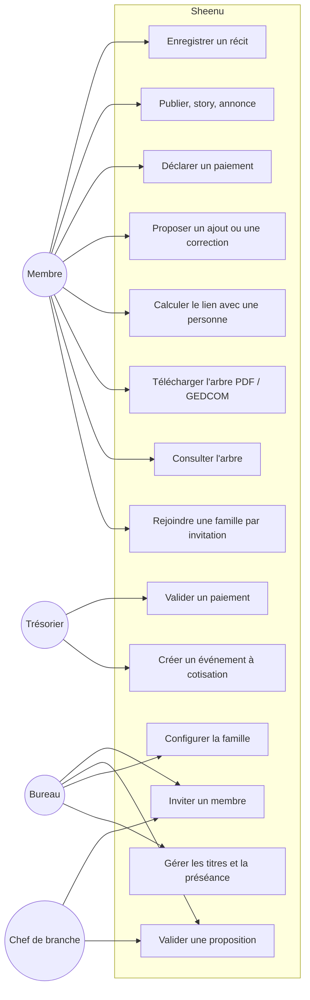

# 01 — Dossier d'analyse

> Projet : **Sheenu**, plateforme de mémoire et d'organisation des grandes familles africaines.
> Version 1.0 — 27 octobre 2026 — Auteur : Ousmane Mfochivé

## 1. Contexte et problème

Les grandes familles africaines s'organisent aujourd'hui dans des groupes WhatsApp. Quand la famille dépasse quelques centaines de personnes, ce modèle ne tient plus :

- on ne sait plus **qui fait partie de la famille** ni **quel lien exact** on a avec chacun ;
- l'**arbre généalogique** n'existe que dans la tête de quelques anciens, ou dans des cahiers ;
- les **histoires** racontées en langues locales se perdent au décès des anciens ;
- les **cotisations** sont suivies par messages texte retapés régulièrement par un responsable, sans historique fiable ;
- les **titres** traditionnels (Nji, Pomafon, Kom, Mfon…) et l'ordre de préséance ne sont pris en compte par aucun outil existant.

**Cas d'étude** : la famille paternelle de l'auteur, organisée en association, compte plus de 1 000 membres connus sur au moins 6 générations, majoritairement au Cameroun et en Afrique, avec une diaspora mondiale. Sa racine est la reine Ngougouré Chetfon (pays bamoun), dont descendent plusieurs lignées anoblies au rang de Pomafon Chetfon et la lignée royale des Mfon jusqu'au roi actuel.

## 2. Objectifs

| # | Objectif | Indicateur de réussite |
|---|---|---|
| O1 | Disposer d'un **registre fiable** des membres et de leurs liens | 100 % des membres actifs de l'association enregistrés et rattachés à l'arbre |
| O2 | Voir et **télécharger l'arbre** à tout moment | Arbre consultable sur mobile et web, export PDF/PNG et GEDCOM |
| O3 | Connaître **le lien exact** entre deux personnes | Calcul automatique du chemin et du nom du lien |
| O4 | **Respecter les titres** et la préséance | Badges et ordre de préséance appliqués partout |
| O5 | **Préserver les histoires** dans leur langue d'origine | Récits audio rattachés aux personnes, avec traductions validées |
| O6 | **Fluidifier les cotisations** | Calcul automatique, suivi en temps réel, historique permanent |
| O7 | Faire vivre la famille | Fil d'actualité, stories, annonces, anniversaires |

## 3. Périmètre

**Dans le périmètre** : espaces familiaux privés, arbre, fiches, titres, gouvernance contributive, cotisations, récits, vie sociale, notifications, export des données.

**Hors périmètre (pour l'instant)** : pages publiques, liens entre familles, tests ADN, recherche dans des archives publiques, paiement intégré (phase 6), messagerie privée (WhatsApp reste le canal de discussion).

## 4. Acteurs

| Acteur | Description | Droits principaux |
|---|---|---|
| **Visiteur** | Personne non connectée | Ouvrir un lien d'invitation, demander un rattachement (phase 6) |
| **Membre** | Personne connectée appartenant à une famille | Consulter l'arbre et les fiches selon la confidentialité, proposer des ajouts, publier, cotiser |
| **Délégué** | Membre qui agit pour un ancien sans smartphone | Droits du membre, au nom de la personne représentée |
| **Chef de branche** | Responsable d'une petite famille | Valider les propositions concernant sa branche, inviter des membres de sa branche |
| **Trésorier** | Membre du bureau | Créer des événements à cotisation, valider les paiements |
| **Secrétaire** | Membre du bureau | Annonces officielles, convocations, procès-verbaux |
| **Bureau / Administrateur** | Responsables de l'association | Configuration de la famille : titres, règles de cotisation, rôles, racine |
| **Système** | Tâches automatiques | Rappels d'anniversaires, résumés hebdomadaires, calculs |

Une même personne peut cumuler plusieurs rôles. Un compte peut appartenir à **autant de familles que nécessaire**, comme à des groupes WhatsApp ; son rôle et sa fiche sont propres à chaque famille.

## 5. Règles métier

### 5.1 Familles et appartenance
- **RG-01** Une famille est un espace **strictement privé**. Aucune donnée n'est visible hors de ses membres.
- **RG-02** Les familles ne sont **pas reliées** entre elles. Un compte appartenant à plusieurs familles possède une fiche personne distincte dans chacune.
- **RG-03** Tout utilisateur peut **créer une famille**, de la plus petite (un foyer : père, mère, enfants) à la plus grande, et appartenir à **autant de familles qu'il le souhaite**, avec un rôle différent dans chacune.
- **RG-04** On entre dans une famille uniquement **par invitation** d'un chef de branche ou du bureau, ou par demande de rattachement validée.
- **RG-05** Chaque famille a **un ancêtre racine**. La racine peut être **remontée** en ajoutant les parents de l'ancêtre racine actuel.

### 5.2 Personnes et liens
- **RG-06** Une **personne** (nœud de l'arbre) est distincte d'un **compte**. Un ancêtre décédé ou un enfant n'a pas de compte.
- **RG-07** Un compte est relié à **au plus une personne par famille**, et une personne à **au plus un compte**.
- **RG-08** Une personne a **au plus deux parents biologiques** ; elle peut avoir en plus des parents adoptifs ou des liens de reconnaissance.
- **RG-09** Une filiation ne peut pas créer de **cycle** (une personne ne peut pas être son propre ascendant).
- **RG-10** Une **union** relie deux personnes ; elle a un type (coutumière, civile, religieuse), des dates et, pour la polygamie, un **rang** (première épouse, deuxième épouse…).
- **RG-11** Chaque lien porte un **niveau de certitude** : *documenté*, *transmis oralement*, *incertain*, et une source facultative.
- **RG-12** La **génération** d'une personne se calcule par rapport à la racine (racine = génération 1). Elle sert notamment au calcul des cotisations.

### 5.3 Gouvernance contributive
- **RG-13** Tout membre peut **proposer** un ajout ou une correction (personne, lien, photo, récit).
- **RG-14** Une proposition concernant une branche est **validée par son chef de branche** ou par le bureau. Les membres du bureau et les chefs de branche peuvent publier directement dans leur périmètre.
- **RG-15** Toute création, modification ou suppression est inscrite au **journal d'audit** (qui, quoi, quand, valeur avant/après).
- **RG-16** On ne supprime pas physiquement une personne : on l'**archive**, pour préserver l'historique.

### 5.4 Titres et préséance
- **RG-17** Un **titre** est défini par la famille ou la communauté : nom, abréviation, badge, **rang de préséance** (plus petit = plus élevé).
- **RG-18** Un titre est **conféré par une autorité extérieure** (chefferie, royaume). La plateforme l'enregistre avec l'autorité, la date et un justificatif facultatif.
- **RG-19** Un titre transmissible garde la **lignée de ses détenteurs** : prédécesseur, détenteur actuel, successeur désigné.
- **RG-20** Les listes de personnes sont triées par défaut selon la **préséance** (titre le plus élevé, puis génération, puis âge), et le nom est affiché précédé du titre.

### 5.5 Confidentialité
- **RG-21** Chaque membre choisit la visibilité de ses coordonnées : *toute la famille*, *ma branche*, *bureau seulement*, *moi seul*.
- **RG-22** Les informations délicates (filiations sensibles, certains récits) peuvent être restreintes à la branche, au bureau ou aux anciens.

### 5.6 Cotisations
- **RG-23** Les **règles de cotisation** reprennent les textes de l'association : montant par **génération** (ou par catégorie), exemptions éventuelles (enfants mineurs, étudiants…).
- **RG-24** À la création d'un **événement à cotisation** (deuil, mariage, projet), le système calcule le **montant dû par chaque membre** selon les règles en vigueur à cette date.
- **RG-25** Un membre **déclare** un paiement (montant, moyen, preuve) ; le **trésorier le valide** ou le rejette. Seuls les paiements validés comptent dans les totaux.
- **RG-26** L'historique des cotisations est **permanent** et non modifiable après clôture de l'événement.

### 5.7 Récits
- **RG-27** Le **média original** (audio ou vidéo en langue locale) est la source de référence et n'est jamais remplacé.
- **RG-28** Transcriptions et traductions sont des **couches** rattachées au récit, chacune avec auteur, langue et statut (*brouillon*, *à valider*, *validée*).
- **RG-29** Un récit est rattaché à **une ou plusieurs personnes** de l'arbre (narrateur, personnes évoquées).

## 6. Cas d'utilisation

### Cas détaillés prioritaires (phase 1)

**UC1 — Rejoindre une famille par invitation**
- *Acteur* : visiteur invité.
- *Préconditions* : un chef de branche ou le bureau a créé une invitation, éventuellement liée à une fiche personne existante.
- *Scénario* : 1) le visiteur ouvre le lien reçu sur WhatsApp ; 2) il voit le nom de la famille et de la personne qui l'invite ; 3) il crée son compte (nom, e-mail ou téléphone, mot de passe) ou se connecte s'il a déjà un compte ; 4) il est rattaché à la famille, et à sa fiche personne si l'invitation en désignait une.
- *Exceptions* : invitation expirée ou déjà utilisée ; compte déjà membre de cette famille.

**UC2 — Consulter l'arbre**
- *Acteur* : membre.
- *Scénario* : 1) le membre ouvre l'arbre, centré par défaut sur sa propre fiche ; 2) il choisit une vue (ascendants, descendants, branche, depuis la racine) ; 3) il zoome, recherche une personne, recentre l'arbre ; 4) il ouvre une fiche.
- *Règles* : RG-20, RG-21, RG-22.

**UC3 — Télécharger l'arbre**
- *Scénario* : depuis la vue courante, le membre choisit *PNG*, *PDF* ou *GEDCOM* ; le fichier respecte la confidentialité (aucune coordonnée privée exportée).

**UC4 — Calculer le lien**
- *Scénario* : le membre choisit deux personnes (par défaut lui-même et une autre) ; le système affiche l'ancêtre commun le plus proche, le chemin et le nom du lien (« cousin au 2ᵉ degré », « grand-oncle »…).

**UC5 / UC6 — Proposer puis valider**
- *Scénario* : un membre propose « ajouter X comme enfant de Y » ; le chef de branche de Y reçoit la proposition, l'accepte (l'arbre est mis à jour, l'audit est écrit) ou la refuse avec un motif.

## 7. Exigences non fonctionnelles

| Code | Exigence |
|---|---|
| ENF-01 Sécurité | Isolation stricte des familles (contrôle applicatif **et** Row Level Security PostgreSQL), mots de passe hachés (bcrypt/argon2), jetons JWT à durée courte, HTTPS partout |
| ENF-02 Confidentialité | Aucun index public, aucune donnée dans les URL, export complet des données sur demande, suppression de compte possible |
| ENF-03 Performance | Arbre de 5 000 personnes chargé en moins de 2 s ; calcul de lien en moins de 300 ms |
| ENF-04 Connectivité | Application utilisable avec une connexion lente ; cache local et mode hors ligne partiel sur mobile |
| ENF-05 Coût | Fonctionnement à **coût nul** au démarrage (offres gratuites), photos compressées, vidéos limitées |
| ENF-06 Langues | Interface en français et en anglais ; contenus multilingues pour les récits |
| ENF-07 Portabilité | Export GEDCOM 5.5.1 ; pas d'enfermement chez un fournisseur |
| ENF-08 Maintenabilité | Code typé (Python typé, TypeScript), tests automatisés, CI, documentation versionnée |
| ENF-09 Accessibilité | Grandes zones tactiles, contrastes suffisants, lisible par les anciens |
| ENF-10 Culture | Titres, préséance, polygamie et filiations coutumières pris en charge nativement |

## 8. Contraintes et hypothèses

- Développeur principal unique, développement progressif, tests par la famille au fil de l'eau.
- Ressources **gratuites** uniquement au début.
- La plupart des membres ont un smartphone et WhatsApp ; les anciens passent par un délégué.
- L'API WhatsApp Business et l'intégration Mobile Money étant payantes, elles sont reportées (phase 6).
- La traduction automatique des langues locales étant peu fiable, la traduction reste humaine au départ.

## 9. Découpage en lots

| Phase | Contenu | Livrable |
|---|---|---|
| **1. Cœur** | Comptes, familles, invitations, personnes, filiations, unions, arbre, fiche, calcul de lien, export PNG/PDF/GEDCOM | API + web + mobile minimal testés sur le noyau familial |
| **2. Gouvernance** | Rôles fins, propositions et validation, titres et préséance, import GEDCOM, audit consultable | Ouverture à la grande famille |
| **3. Cotisations** | Règles, événements, déclarations, validation, tableau transparent, rapports | Remplacement des listes WhatsApp |
| **4. Vie sociale** | Fil, stories, annonces, mémoriaux, anniversaires | Engagement quotidien |
| **5. Mémoire** | Récits audio/vidéo, transcriptions, traductions, albums, frise | Préservation des histoires |
| **6. Intégrations** | WhatsApp, Mobile Money, carte de la diaspora, rattachement | Automatisation |

## 10. Glossaire

| Terme | Définition |
|---|---|
| **Racine** | Ancêtre le plus ancien connu, point de départ de l'arbre d'une famille |
| **Branche** | Ensemble des descendants d'une personne, généralement d'un enfant de la racine ou d'un chef de petite famille |
| **Génération** | Distance à la racine, la racine étant la génération 1 |
| **Filiation** | Lien parent → enfant (biologique, adoptif, reconnu) |
| **Union** | Lien entre deux conjoints (coutumier, civil, religieux) |
| **Préséance** | Ordre de priorité protocolaire fondé sur les titres |
| **Nji** | Titre de noblesse bamoun conféré aux princes et notables |
| **Pomafon** | Titre bamoun des descendants anoblis de la lignée royale |
| **Kom** | Notable, conseiller du roi en pays bamoun |
| **Mfon** | Roi des Bamoun |
| **GEDCOM** | Format standard d'échange de données généalogiques |
| **Délégué** | Membre qui agit pour le compte d'un autre membre sans smartphone |

> Les définitions des titres sont indicatives ; elles seront validées par les anciens de la famille.
