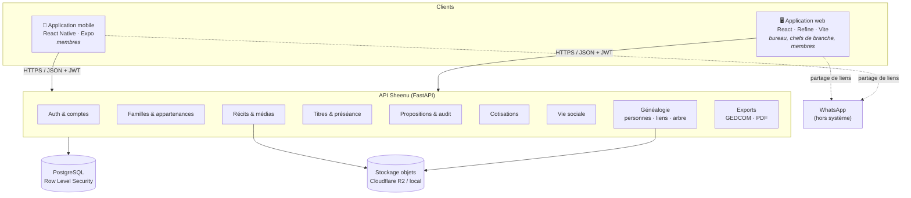
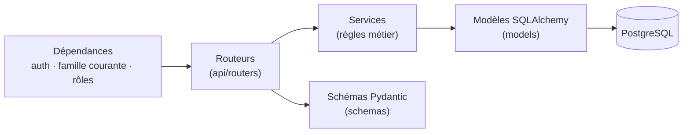
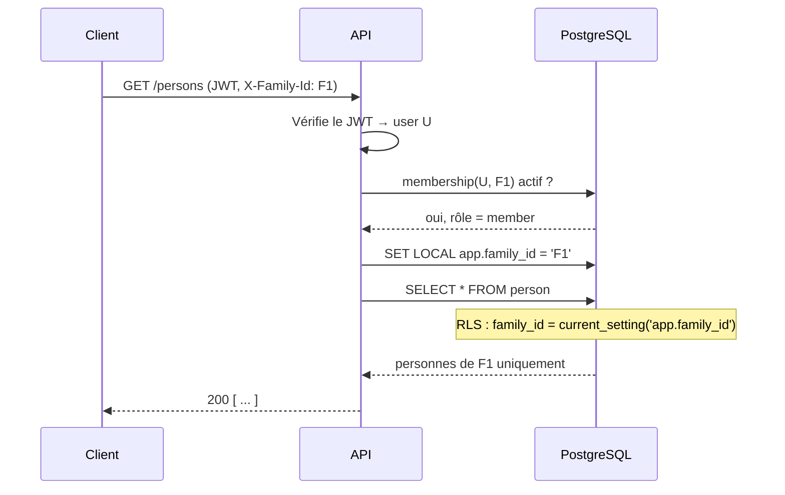
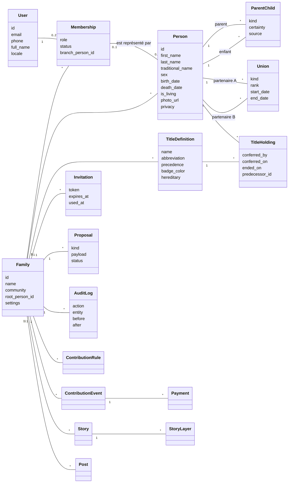
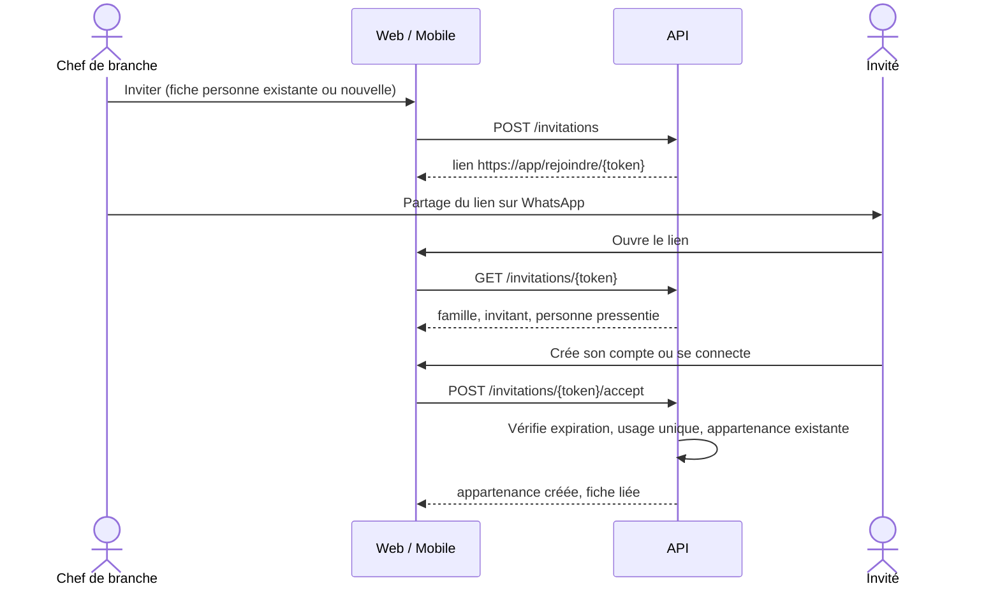
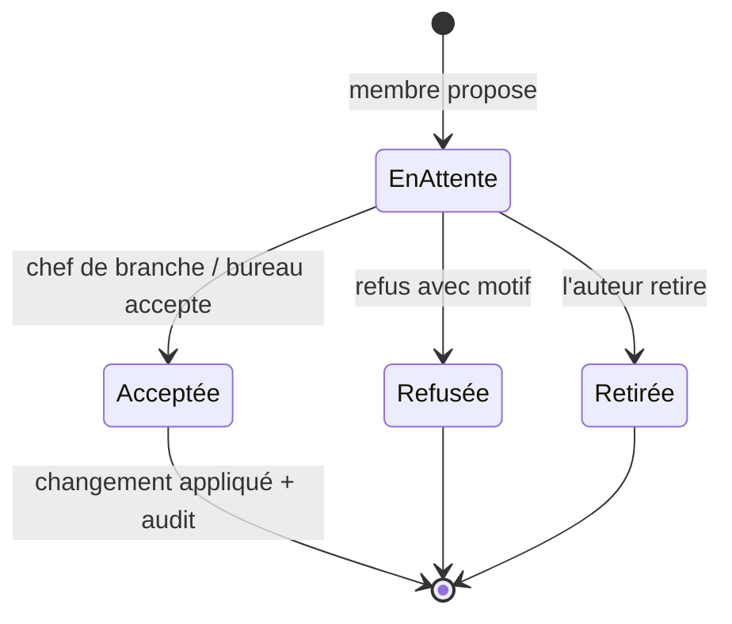
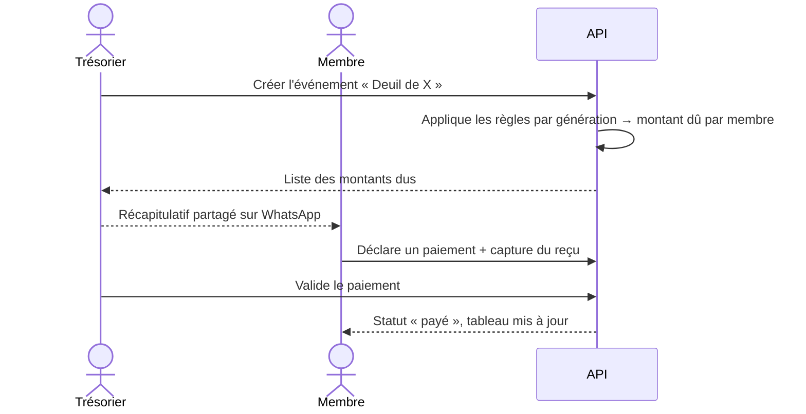
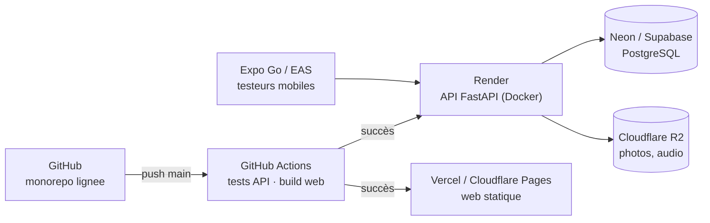

# 02 — Conception globale

> Version 1.0 — 27 octobre 2026

## 1. Vue d'ensemble

Sheenu est composée de trois applications clientes et d'une API unique adossée à PostgreSQL. WhatsApp reste en dehors du système : il sert de canal pour partager les liens d'invitation et les récapitulatifs.



## 2. Choix techniques

| Couche | Technologie | Justification |
|---|---|---|
| API | **Python 3.12+, FastAPI** | Léger en mémoire (compatible offres gratuites), typage avec Pydantic, OpenAPI automatique |
| ORM / migrations | **SQLAlchemy 2.0, Alembic** | Mappage typé, migrations versionnées |
| Base de données | **PostgreSQL 16** | Requêtes récursives pour l'arbre, Row Level Security pour l'isolation, JSONB pour l'audit |
| Authentification | **JWT** (accès 30 min + rafraîchissement 30 jours), mots de passe **bcrypt** | Sans état, simple à héberger |
| Web | **React 18, TypeScript, Refine, Ant Design, Vite** | Refine accélère les écrans de gestion (listes, formulaires, droits) |
| Visualisation de l'arbre | **family-chart** (D3) + rendu maison pour l'export | Conçu pour la généalogie, gère conjoints multiples |
| Export image/PDF | **html-to-image + jsPDF** côté client | Aucun coût serveur |
| Mobile | **React Native, Expo, TypeScript** | Même langage que le web, types partagés, Expo Go pour les testeurs |
| Stockage fichiers | **Cloudflare R2** (compatible S3), disque local en développement | Sortie de données gratuite |
| CI | **GitHub Actions** | Gratuit pour les dépôts privés dans la limite des minutes incluses |
| Hébergement | **Render** (API), **Neon** ou **Supabase** (PostgreSQL), **Vercel** ou **Cloudflare Pages** (web) | Offres gratuites |

## 3. Architecture de l'API

L'API suit une architecture en couches, organisée par **module métier**.



- **Routeurs** : HTTP uniquement (validation d'entrée, codes de retour).
- **Services** : règles métier (RG-xx), transactions, audit.
- **Modèles** : tables et relations.
- **Dépendances** : utilisateur courant, famille courante (en-tête `X-Family-Id`), vérification du rôle.

### Contexte familial

Chaque requête métier porte l'en-tête **`X-Family-Id`**. L'API vérifie que l'utilisateur est membre actif de cette famille, puis positionne la variable de session PostgreSQL `app.family_id` pour que la **Row Level Security** filtre toutes les tables. Une erreur de code applicatif ne peut donc pas faire fuiter les données d'une autre famille.



## 4. Modèle de domaine



Les entités de cotisation, de récit et de publication figurent ici pour fixer l'architecture ; elles sont implémentées dans les phases 3 à 5.

## 5. Sécurité

| Menace | Contre-mesure |
|---|---|
| Accès aux données d'une autre famille | Vérification d'appartenance + RLS PostgreSQL |
| Vol de mot de passe | bcrypt, politique de longueur minimale, limitation des tentatives |
| Vol de jeton | JWT d'accès court (30 min), jeton de rafraîchissement révocable |
| Invitation détournée | Jeton aléatoire de 32 octets, expiration (7 jours par défaut), usage unique |
| Élévation de privilèges | Contrôle du rôle côté serveur pour chaque action sensible |
| Modification silencieuse | Journal d'audit systématique, suppression logique |
| Injection | ORM paramétré, validation Pydantic |
| Fuite par export | Les exports appliquent les mêmes règles de confidentialité que l'affichage |

### Matrice des rôles (phase 1–2)

| Action | Membre | Chef de branche | Trésorier | Bureau / Admin |
|---|:-:|:-:|:-:|:-:|
| Voir l'arbre et les fiches | ✅ | ✅ | ✅ | ✅ |
| Modifier sa propre fiche | ✅ | ✅ | ✅ | ✅ |
| Proposer un ajout | ✅ | ✅ | ✅ | ✅ |
| Ajouter directement dans sa branche | — | ✅ | — | ✅ |
| Valider une proposition | — | ✅ (sa branche) | — | ✅ |
| Inviter | — | ✅ (sa branche) | — | ✅ |
| Gérer titres, règles, rôles | — | — | — | ✅ |
| Gérer les cotisations | — | — | ✅ | ✅ |

## 6. Flux principaux

### 6.1 Invitation



### 6.2 Proposition et validation (phase 2)



### 6.3 Cotisation (phase 3)



## 7. Déploiement



| Environnement | API | Base | Web |
|---|---|---|---|
| Local | `uvicorn` | PostgreSQL local ou Docker | `vite dev` |
| Test (CI) | pytest | PostgreSQL service GitHub Actions | `vite build` |
| Production | Render (offre gratuite, mise en veille) | Neon ou Supabase (offre gratuite) | Vercel ou Cloudflare Pages |

## 8. Organisation du code

```
lignee/
├── docs/            Analyse, conception, décisions
├── api/             FastAPI
│   ├── app/
│   │   ├── core/    config, sécurité, base de données
│   │   ├── models/  SQLAlchemy
│   │   ├── schemas/ Pydantic
│   │   ├── services/ règles métier (généalogie, parenté, GEDCOM)
│   │   └── routers/ endpoints
│   ├── alembic/     migrations
│   └── tests/
├── web/             React + Refine
├── mobile/          Expo
└── .github/workflows/
```
