# 06 — Description fonctionnelle détaillée

> Version 1.0 — 27 octobre 2026. À l'intention des développeurs qui reprennent ou font évoluer Sheenu.

Ce document décrit **chaque fonctionnalité** de la plateforme telle qu'elle est livrée : à quoi elle sert, qui peut s'en servir, les règles qu'elle applique, les points d'entrée de l'API, les écrans web et mobile (avec captures), les erreurs et cas limites, et l'endroit du code où elle vit.

Il complète les autres documents :

| Document | Pour |
|---|---|
| [01 — Analyse](01-analyse.md) | Besoins, acteurs, règles de gestion RG-01 à RG-29 |
| [02 — Conception globale](02-conception-globale.md) | Architecture, choix techniques |
| [03 — Conception détaillée](03-conception-detaillee.md) | Modèle de données, algorithmes, contrats d'API |
| [04 — Déploiement](04-deploiement.md) | Mise en ligne sur les offres gratuites |
| [05 — Guide du code](05-guide-du-code.md) | Organisation du code, conventions |
| [07 — Tests et sécurité](07-tests-et-securite.md) | Tests, essai de charge, mesures de sécurité |

Les captures viennent de la **famille de démonstration** (`python -m scripts.seed_demo`, compte `demo@lignee.app`) : 535 personnes fictives sur 6 générations. Elles sont dans [`docs/captures/`](captures).

## Sommaire

| | Fonctionnalité | Domaine |
|---|---|---|
| [F-01](#f-01--comptes-et-connexion) | Comptes et connexion | Accès |
| [F-02](#f-02--mon-compte-et-sessions) | Mon compte et sessions | Accès |
| [F-03](#f-03--plusieurs-familles) | Plusieurs familles | Familles |
| [F-04](#f-04--accueil-de-la-famille) | Accueil de la famille | Familles |
| [F-05](#f-05--membres-et-rôles) | Membres et rôles | Familles |
| [F-06](#f-06--invitations-personnelles) | Invitations personnelles | Familles |
| [F-07](#f-07--lien-et-demandes-de-rattachement) | Lien et demandes de rattachement | Familles |
| [F-08](#f-08--notifications) | Notifications | Familles |
| [F-09](#f-09--personnes-et-fiches) | Personnes et fiches | Généalogie |
| [F-10](#f-10--filiations-et-unions) | Filiations et unions | Généalogie |
| [F-11](#f-11--arbre-interactif-et-exports) | Arbre interactif et exports | Généalogie |
| [F-12](#f-12--lien-de-parenté) | Lien de parenté | Généalogie |
| [F-13](#f-13--titres-et-préséance) | Titres et préséance | Généalogie |
| [F-14](#f-14--périmètre-décriture-et-propositions) | Périmètre d'écriture et propositions | Gouvernance |
| [F-15](#f-15--fiches-confiées-délégation) | Fiches confiées (délégation) | Gouvernance |
| [F-16](#f-16--journal-de-la-famille) | Journal de la famille | Gouvernance |
| [F-17](#f-17--gedcom-doublons-et-fusion) | GEDCOM, doublons et fusion | Gouvernance |
| [F-18](#f-18--réunir-deux-familles) | Réunir deux familles | Gouvernance |
| [F-19](#f-19--barèmes-de-cotisation) | Barèmes de cotisation | Cotisations |
| [F-20](#f-20--collectes-et-parts-dues) | Collectes et parts dues | Cotisations |
| [F-21](#f-21--paiements) | Paiements | Cotisations |
| [F-22](#f-22--récapitulatif-relances-export-clôture) | Récapitulatif, relances, export, clôture | Cotisations |
| [F-23](#f-23--paiement-mobile-money) | Paiement Mobile Money | Cotisations |
| [F-24](#f-24--fil-de-la-famille) | Fil de la famille | Vie sociale |
| [F-25](#f-25--stories) | Stories | Vie sociale |
| [F-26](#f-26--modération) | Modération | Vie sociale |
| [F-27](#f-27--mémorial-et-anniversaires) | Mémorial et anniversaires | Vie sociale |
| [F-28](#f-28--récits-et-relecture) | Récits et relecture | Mémoire |
| [F-29](#f-29--albums-et-reconnaissance) | Albums et reconnaissance | Mémoire |
| [F-30](#f-30--frise) | Frise | Mémoire |
| [F-31](#f-31--diaspora) | Diaspora | Intégrations |
| [F-32](#f-32--résumé-de-la-semaine) | Résumé de la semaine | Intégrations |
| [F-33](#f-33--hors-connexion-et-synchronisation) | Hors connexion et synchronisation | Mobile |
| [F-34](#f-34--supervision-de-la-plateforme) | Supervision de la plateforme | Plateforme |
| [F-35](#f-35--sécurité-transverse) | Sécurité transverse | Plateforme |

## Conventions communes

**Appels.** Base `/api/v1`. Authentification `Authorization: Bearer <jeton d'accès>` (30 minutes) ; contexte familial `X-Family-Id: <uuid>` pour toute route d'une famille. Les listes paginées renvoient `{items, total}` (`skip`, `limit`). Les actions qui créent quelque chose acceptent `Idempotency-Key` (F-33, F-35).

**Erreurs.** Toujours `{"detail": {"code": "...", "message": "..."}}`, le message est en français et peut être affiché tel quel.

| HTTP | Codes métier rencontrés |
|---|---|
| 400 | `validation_error`, `already_reviewed`, `note_required`, `weak_password`, `invalid_invitation`, `invalid_code`, `invalid_image`, `invalid_media`, `file_too_large`, `invalid_gedcom`, `is_root`, `last_admin`, `forbidden_role`, `not_deceased`, `same_family`, `self`, `event_closed` |
| 401 | `not_authenticated`, `invalid_credentials`, `token_expired` |
| 403 | `not_a_member`, `forbidden`, `out_of_scope`, `account_disabled` |
| 404 | `not_found` (y compris pour une ressource d'une autre famille) |
| 409 | `already_exists`, `cycle_detected`, `too_many_parents`, `both_have_accounts`, `in_progress` (idempotence) |
| 410 | `family_merged` |
| 413 | `too_large` |
| 429 | `rate_limited` (avec `Retry-After`), `account_locked` |
| 500 | `server_error` (avec numéro d'incident) |

**Rôles** (`membership.role`), un par famille :

| Code | Libellé | En bref |
|---|---|---|
| `admin` | Administrateur | Tout dans la famille |
| `branch_head` | Chef de branche | Écrit et valide dans sa branche, invite, place les demandes de rattachement |
| `treasurer` | Trésorier | Gère les cotisations |
| `secretary` | Secrétaire | Annonces officielles, modération, relecture des récits |
| `member` | Membre | Lit tout, écrit dans son périmètre, propose le reste |

La « modération » désigne `admin` et `secretary` ; les « gardiens de la mémoire » désignent `admin`, `secretary` et `branch_head`.

**Où est le code.** API : `api/app/modules/<module>/` (`router.py` pour les routes, `service.py` pour la logique). Web : `web/src/features/<module>/`. Mobile : `mobile/src/screens/`. La logique de graphe (générations, préséance, parenté) est dans `api/app/genealogy/`.

---

## F-01 — Comptes et connexion

**Objectif.** Permettre à chacun d'avoir un compte personnel, avec un e-mail ou un numéro de téléphone, et de s'y connecter sur le web et le mobile.

**Acteurs.** Tout visiteur.

**Règles.**

- Un compte s'identifie par un e-mail **ou** un téléphone (au moins l'un des deux), unique sur la plateforme (`already_exists`).
- Mot de passe : 8 caractères au moins, ni courant (liste intégrée), ni contenant le nom ou l'identifiant (`weak_password`).
- Connexion : `login` accepte e-mail ou téléphone. Après 5 échecs, le compte est verrouillé 15 minutes, puis la durée double à chaque nouvelle série (4 h au plus) : `429 account_locked`. Le temps de réponse est le même que le compte existe ou non.
- La connexion ouvre une **session par appareil** et renvoie un jeton d'accès (30 min) et un jeton de rafraîchissement (30 jours, usage unique, renouvelé à chaque rafraîchissement). Rejouer un ancien jeton de rafraîchissement ferme toutes les sessions du compte (F-35).
- Un compte suspendu par l'opérateur reçoit `403 account_disabled`.
- Débit : 10 connexions par minute et 5 inscriptions par heure par adresse IP.

**API.**

| Méthode | Chemin | Description |
|---|---|---|
| POST | `/auth/register` | `full_name`, `email` ou `phone`, `password` → jetons |
| POST | `/auth/login` | `login`, `password` → jetons |
| POST | `/auth/refresh` | Rotation du jeton de rafraîchissement |
| GET / PATCH | `/auth/me` | Profil (nom, e-mail, téléphone) |

**Écrans.** Web `/connexion`, `/inscription` ; mobile, écran de connexion. Le motif ntienya du panneau gauche est le logo de la plateforme.

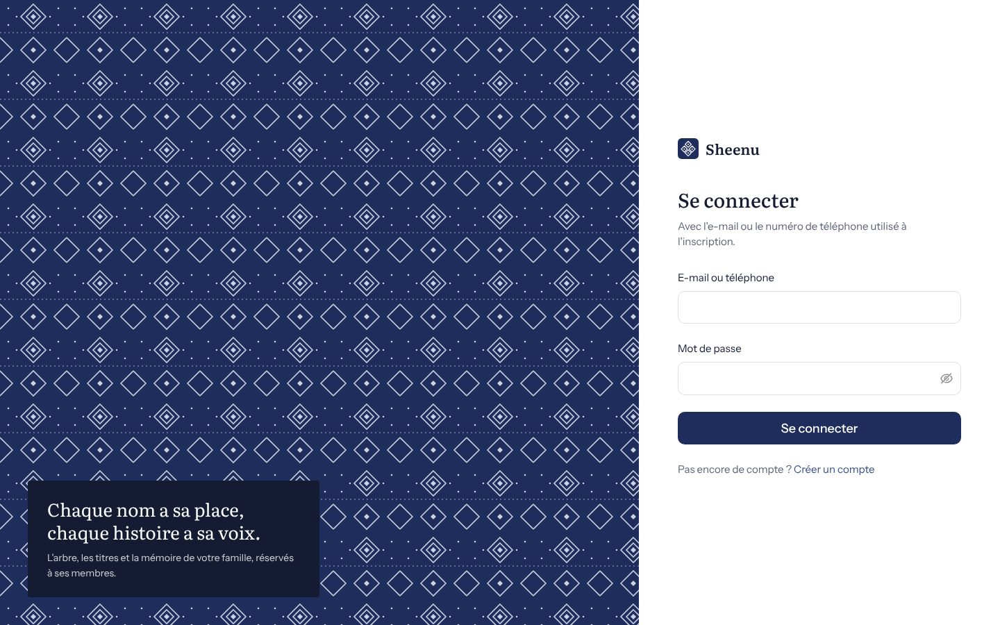

**Code.** `api/app/modules/auth/`, `api/app/core/security.py` ; `web/src/features/auth/AuthPages.tsx`, `web/src/providers/authProvider.ts` ; `mobile/src/screens/LoginScreen.tsx`, `mobile/src/api.ts` (rafraîchissement dédoublonné).

---

## F-02 — Mon compte et sessions

**Objectif.** Donner à chacun la maîtrise de son compte : mot de passe, appareils connectés, déconnexion à distance.

**Acteurs.** Tout compte connecté.

**Règles.**

- Changer de mot de passe exige l'ancien ; les autres sessions sont fermées, l'appareil courant reçoit de nouveaux jetons. 5 changements par heure au plus.
- Chaque session affiche l'appareil (navigateur ou application, système), l'adresse IP et la dernière activité. On peut fermer une session, ou toutes (`logout-all` incrémente `token_version`, ce qui invalide aussi les jetons d'accès en cours).
- Le lien vers la supervision n'apparaît que pour un opérateur (F-34).

**API.** `POST /auth/password`, `GET /auth/sessions`, `DELETE /auth/sessions/{id}`, `POST /auth/logout`, `POST /auth/logout-all`.

**Écrans.** Web `/compte` (lien sous le nom en bas de la barre latérale, et depuis « Vos familles »).

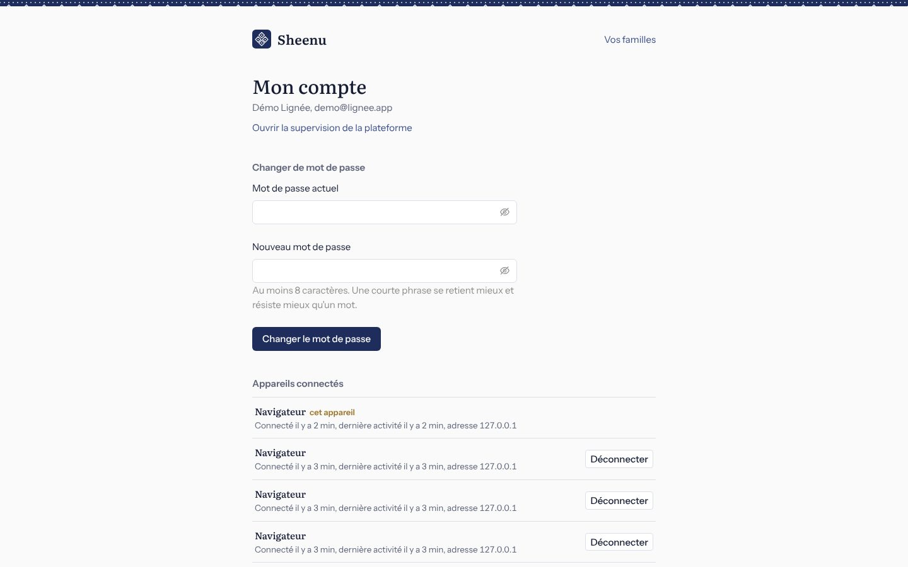

**Code.** `api/app/modules/auth/router.py` ; `web/src/features/account/AccountPage.tsx`.

---

## F-03 — Plusieurs familles

**Objectif.** Comme pour les groupes WhatsApp : un même compte appartient à autant de familles qu'il le souhaite (côté paternel, côté maternel, foyer), avec un rôle et une fiche différents dans chacune.

**Acteurs.** Tout compte connecté.

**Règles.**

- RG-01 à RG-03 : chaque famille est un espace fermé. Rien ne circule d'une famille à l'autre ; la base l'impose par la Row Level Security (F-35).
- Créer une famille fait de son auteur l'administrateur et crée sa fiche personne dans cette famille. Une micro-famille (un foyer) est une famille comme une autre.
- RG-07 : un compte a au plus une fiche par famille.
- Une famille réunie à une autre (F-18) disparaît de la liste ; toute requête sur elle répond `410 family_merged`.

**API.** `GET /families` (mes familles et mon rôle), `POST /families`, `GET /families/current`, `PATCH /families/current` (admin : nom, communauté, description, racine).

**Écrans.** Web `/familles` ; mobile « Vos familles », puis « Plus → Changer de famille ». La famille courante est gardée dans le stockage local (`sheenu.family`) et envoyée dans `X-Family-Id`.

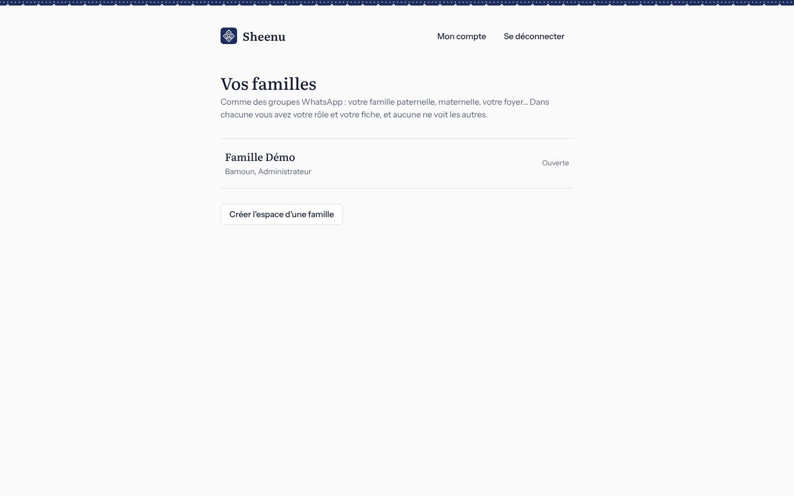

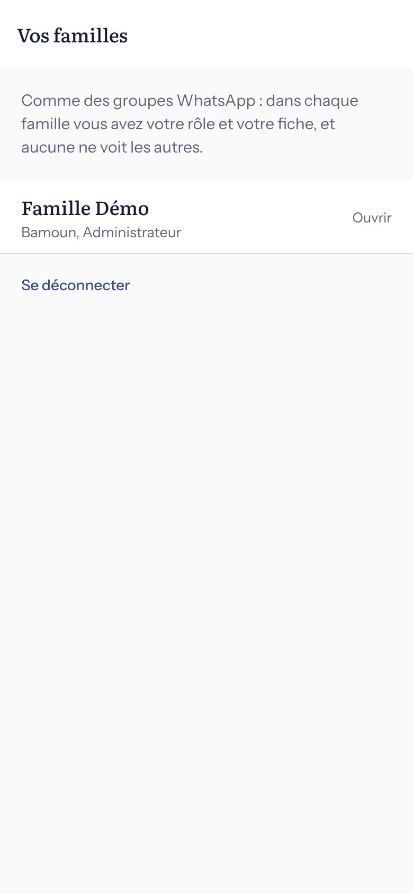

**Code.** `api/app/modules/families/` ; `web/src/features/families/FamiliesPage.tsx` ; `mobile/src/screens/FamiliesScreen.tsx`.

---

## F-04 — Accueil de la famille

**Objectif.** Une page d'entrée qui résume la famille et ce qui concerne le membre.

**Contenu.**

- Chiffres : personnes dans l'arbre, générations, vivants, membres inscrits (`GET /stats`).
- « Ma place dans la famille » : ma fiche et mes parents.
- « Mes cotisations en cours » : ma part et ce que j'ai versé pour chaque collecte ouverte.
- « Les nouvelles de la semaine » (F-32), avec « Partager sur WhatsApp » et « Copier ».
- Anniversaires à venir (F-27).
- Raccourcis « Voir l'arbre », « Ajouter une personne ».

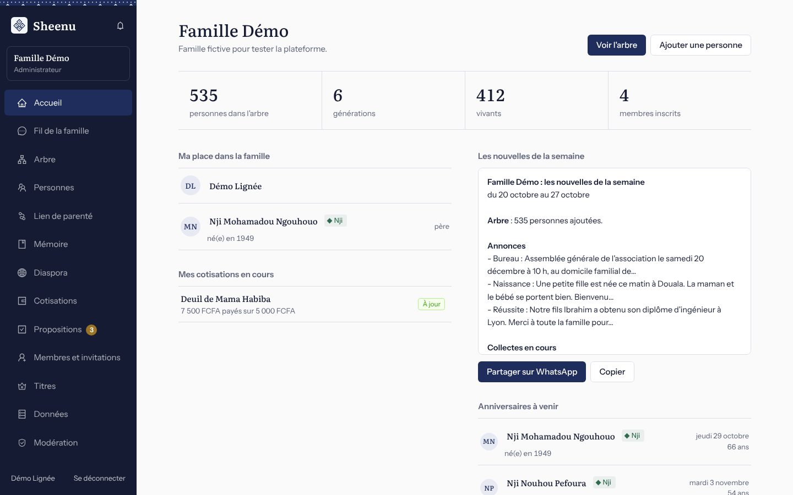

**Code.** `web/src/features/home/` ; `api/app/modules/tree/router.py` (`/stats`), `api/app/modules/overview/`.

---

## F-05 — Membres et rôles

**Objectif.** Voir qui est inscrit et attribuer les rôles.

**Acteurs.** Tout membre consulte ; l'administrateur modifie.

**Règles.**

- L'administrateur change le rôle, le statut (`active`, `suspended`), la fiche liée et, pour un chef de branche, la **personne de branche** (racine de sa branche).
- Il reste toujours au moins un administrateur actif (`last_admin`).
- Un membre suspendu perd l'accès à la famille ; sa fiche reste dans l'arbre.

**API.** `GET /members`, `PATCH /members/{id}`.

**Écrans.** Web `/membres` (« Membres et invitations ») : demandes de rattachement en tête (F-07), tableau des membres, lien de rattachement, invitations en attente.

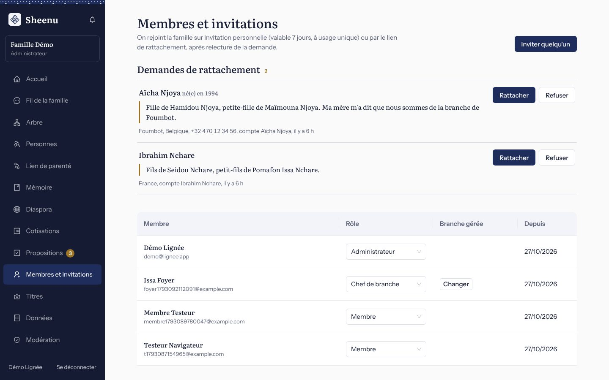

**Code.** `api/app/modules/families/router.py` ; `web/src/features/members/MembersPage.tsx`.

---

## F-06 — Invitations personnelles

**Objectif.** Faire entrer une personne précise dans la famille, en général en lui envoyant le lien par WhatsApp (RG-04).

**Acteurs.** Administrateur, chef de branche.

**Règles.**

- L'invitation porte un rôle et, facultativement, la fiche de la personne invitée : elle y sera reliée en acceptant.
- Le jeton n'est montré qu'**une fois**, à la création. Il est valable 7 jours par défaut (1 à 60) et ne sert qu'une fois (`invalid_invitation` sinon).
- Un chef de branche n'invite que pour une fiche de sa branche et seulement avec le rôle membre (`forbidden` sinon) ; une fiche déjà liée à un compte est refusée (`already_exists`).
- L'aperçu public ne montre que le nom de la famille, l'invitant et la personne pressentie.

**API.** `POST /invitations`, `GET /invitations`, `DELETE /invitations/{id}`, `GET /invitations/token/{t}` (public), `POST /invitations/token/{t}/accept`.

**Écrans.** Fiche → « Plus → Inviter sur Sheenu » (message prêt pour WhatsApp) ; `/membres`, « Inviter quelqu'un » ; page publique `/rejoindre/:token`.

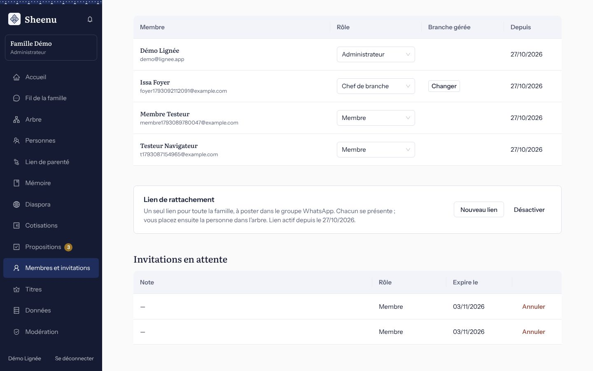

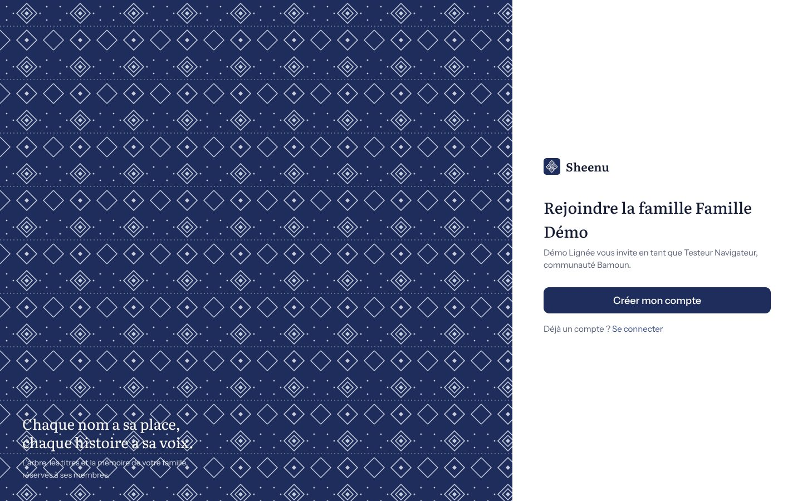

**Code.** `api/app/modules/invitations/` ; `web/src/features/auth/JoinPage.tsx`.

---

## F-07 — Lien et demandes de rattachement

**Objectif.** Un seul lien, posté dans le groupe WhatsApp de la famille, par lequel chacun demande à entrer ; le bureau le place ensuite dans l'arbre.

**Acteurs.** Administrateur (lien) ; visiteur (demande) ; administrateur et chef de branche (traitement).

**Règles.**

- Le lien est montré une seule fois ; « Nouveau lien » invalide l'ancien, « Désactiver » ferme les demandes. Seule l'empreinte du jeton est stockée (`join_link`).
- Le visiteur crée son compte et ne voit que le **nom** de la famille. Il donne son identité, « comment je me rattache à la famille », village, pays et téléphone. 20 demandes par heure et par IP.
- Placement, au choix : **comme enfant** d'une personne de l'arbre (filiation créée avec la certitude « transmis oralement ») ; **sur une fiche existante** sans compte ; **sur une nouvelle fiche** à relier plus tard. Un chef de branche ne place que dans sa branche ; seul l'administrateur nomme un chef de branche à cette occasion (`forbidden_role`).
- Un refus exige un motif ; le visiteur le voit et peut compléter puis renvoyer sa demande.
- Notifications : la demande prévient administrateurs et chefs de branche ; l'acceptation prévient le nouveau membre.

**API.** `GET / POST / DELETE /join-link` ; `GET / POST /join/{token}` ; `GET /join-requests?status=` ; `POST /join-requests/{id}/accept` | `reject`.

**Écrans.**

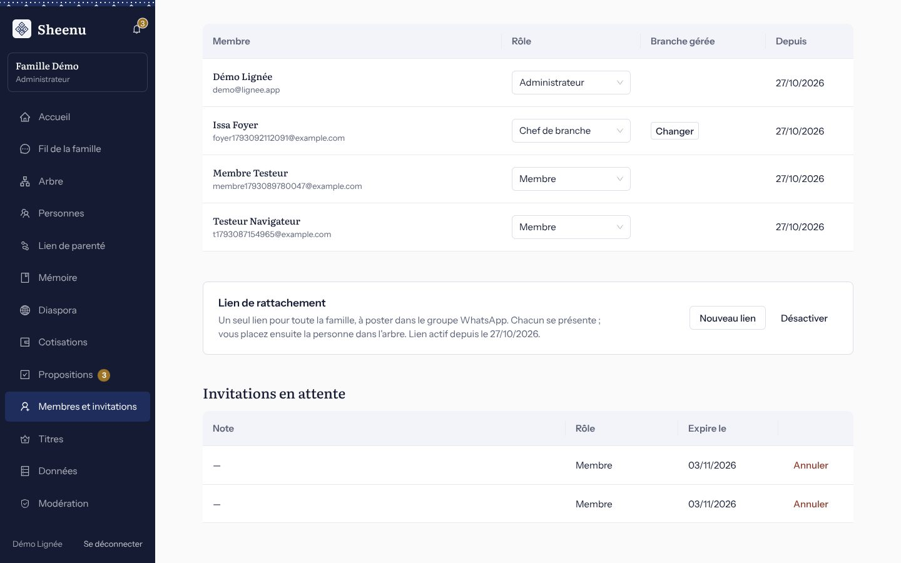

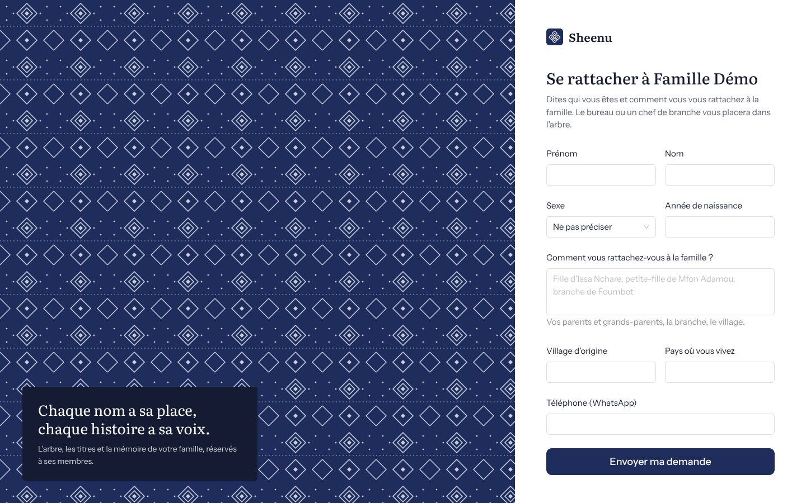

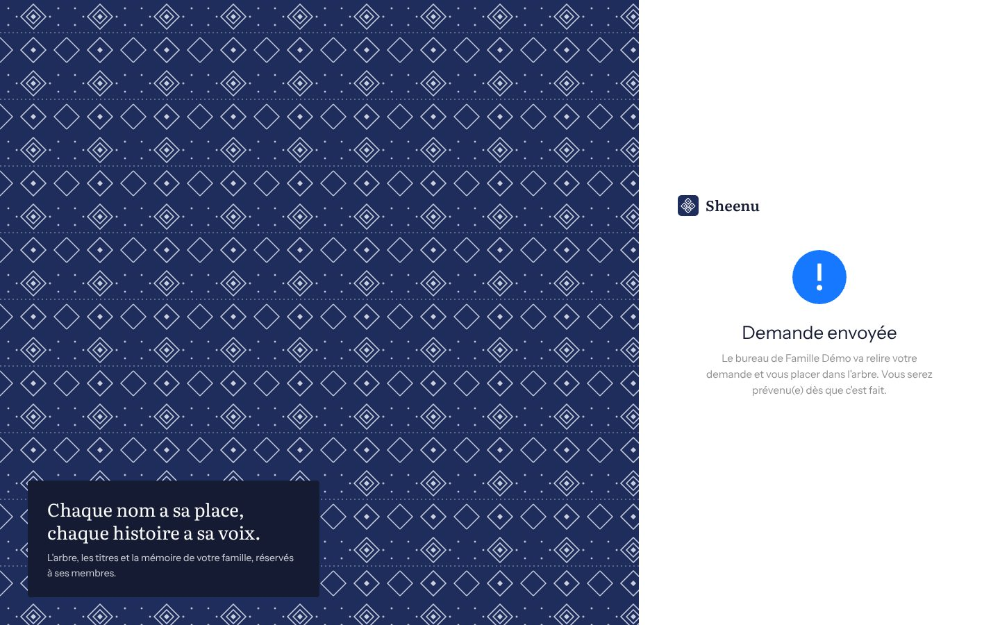

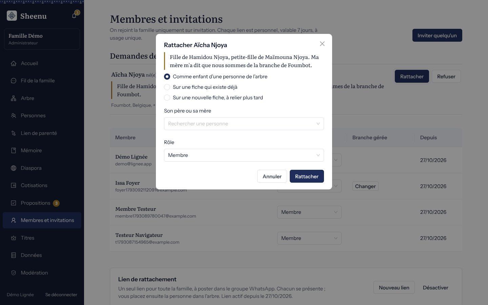

**Code.** `api/app/modules/join/` ; `web/src/features/join/`.

---

## F-08 — Notifications

**Objectif.** Prévenir chaque membre de ce qui le concerne, sans qu'il ait à tout relire.

**Règles.** Créées dans la même transaction que l'action (`app/shared/notify.py`) ; l'auteur de l'action n'est jamais notifié.

| Événement | Destinataires |
|---|---|
| Annonce officielle, annonce de vie | Tous les membres |
| Commentaire | Auteur de la publication |
| Proposition acceptée ou refusée | Auteur, avec le motif |
| Paiement validé ou refusé | Déclarant |
| Texte de récit validé ou refusé | Auteur |
| Demande de rattachement | Administrateurs et chefs de branche |
| Rattachement accepté | Nouveau membre |

**API.** `GET /notifications` (40 dernières et nombre de non lues), `POST /notifications/read` (toutes ou une liste).

**Écrans.** Web : cloche dans la barre latérale, relue chaque minute. Mobile : compteur sur l'onglet « Plus » et écran Notifications.

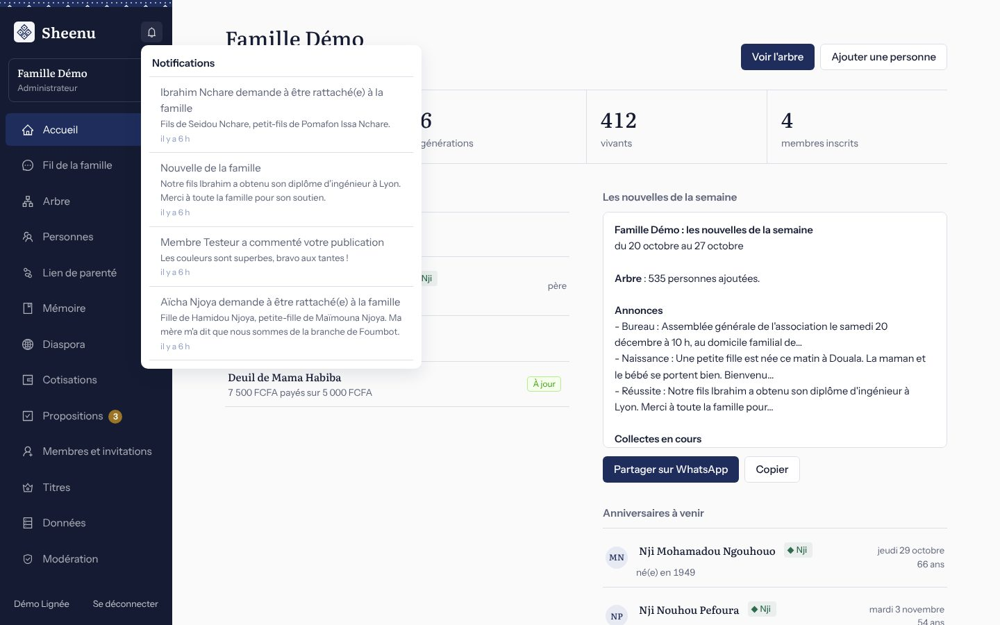

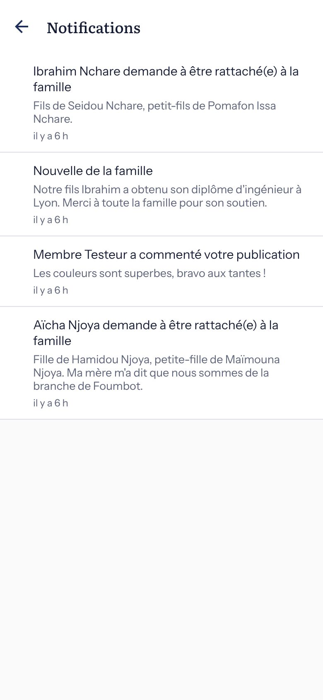

**Code.** `api/app/modules/notifications/`, `api/app/shared/notify.py` ; `web/src/features/notifications/NotificationsBell.tsx` ; `mobile/src/screens/NotificationsScreen.tsx`.

---

## F-09 — Personnes et fiches

**Objectif.** Recenser chaque membre de la lignée, vivant ou décédé, avec ou sans compte (RG-06).

**Règles.**

- Seul le prénom est obligatoire. Une **année approximative** suffit quand la date exacte est inconnue ; un décès peut être sans date.
- Champs : prénom, nom, nom traditionnel, surnom, sexe, vivant, naissance (date ou année, lieu), décès (date, lieu), village d'origine, pays de résidence (alimente F-31), téléphone, e-mail, biographie, photo.
- RG-21 : « Qui voit ces coordonnées » : toute la famille, sa branche, le bureau seulement, personne. Le serveur retire téléphone et e-mail des réponses quand le lecteur n'y a pas droit.
- RG-16 : on n'efface pas une personne, on l'**archive**. Impossible pour la racine (`is_root`) ou pour une fiche liée au compte d'un membre.
- Photo : JPEG, PNG ou WebP, 5 Mo au plus, redimensionnée à 800 px et convertie en WebP.
- Liste triée par **préséance** par défaut (F-13), ou par génération, ou par nom ; recherche sur le nom usuel et le nom traditionnel.
- La fiche montre parents, conjoints, enfants, frères et sœurs, titres, génération, « Pour vous : … » (lien avec le lecteur, F-12), mémoire (F-28, F-29), cotisations de la personne, fiche gérée par (F-15).
- Écriture soumise au périmètre (F-14).

**API.** `GET /persons?q=&sort=&country=&skip=&limit=`, `POST /persons` (avec `parent_ids`, `child_ids`, `spouse_id` pour relier tout de suite), `GET / PATCH / DELETE /persons/{id}`, `POST /persons/{id}/photo`, `GET /persons/{id}/ancestors|descendants?depth=`.

**Écrans.**

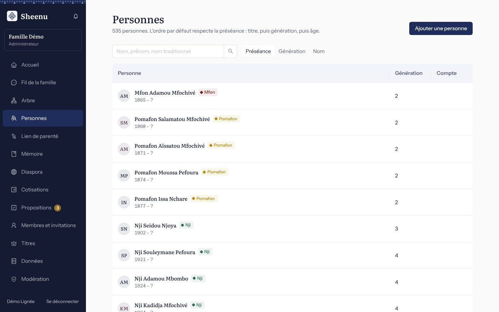

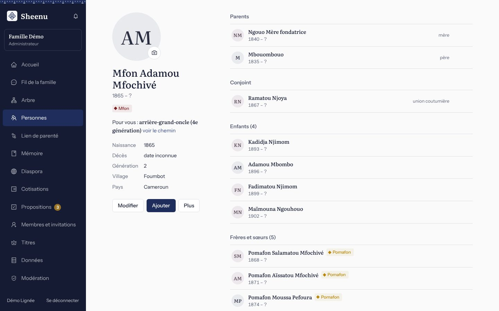

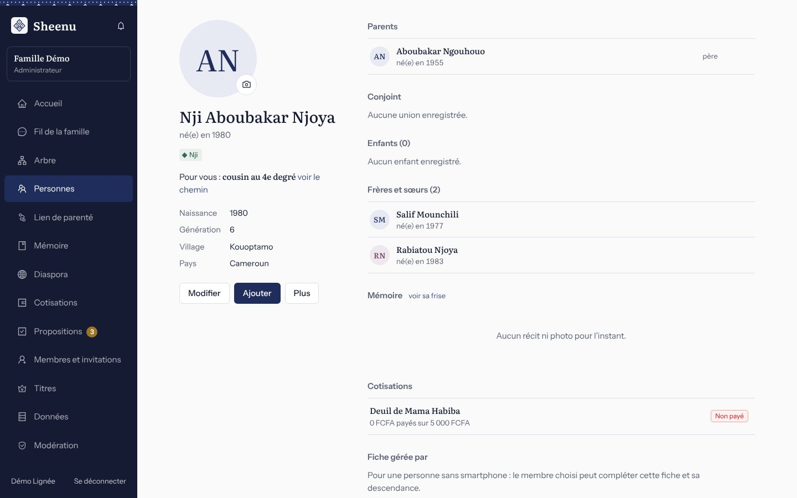

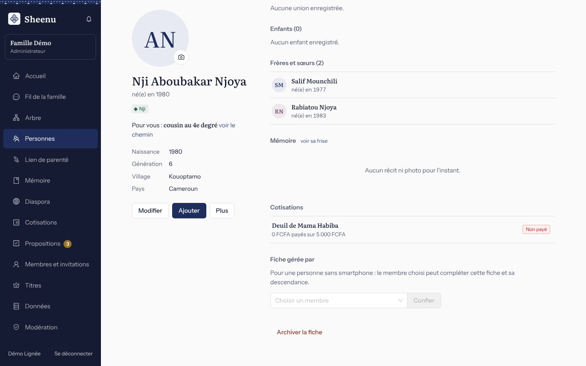

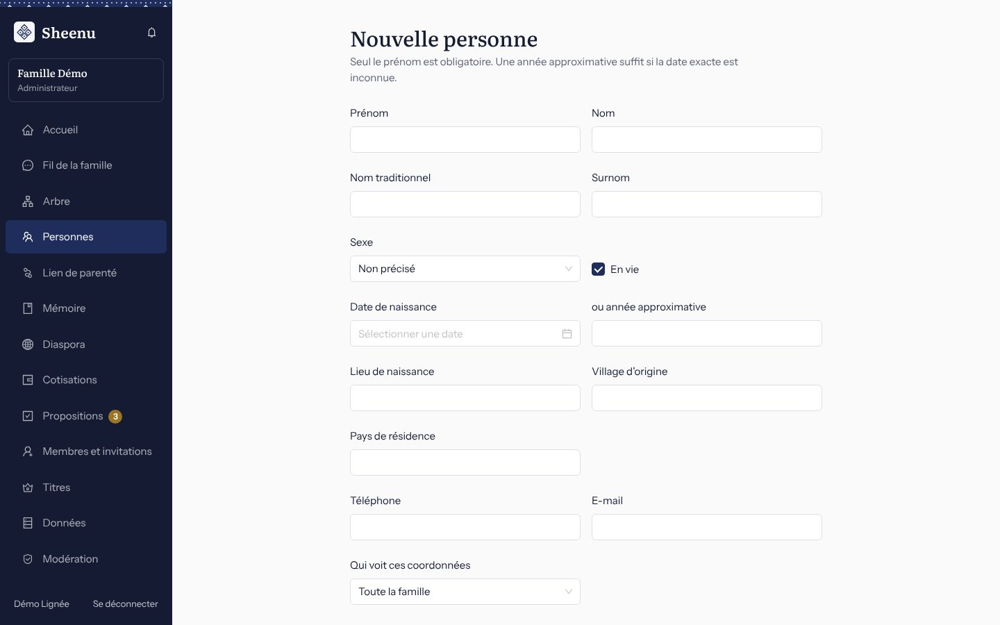

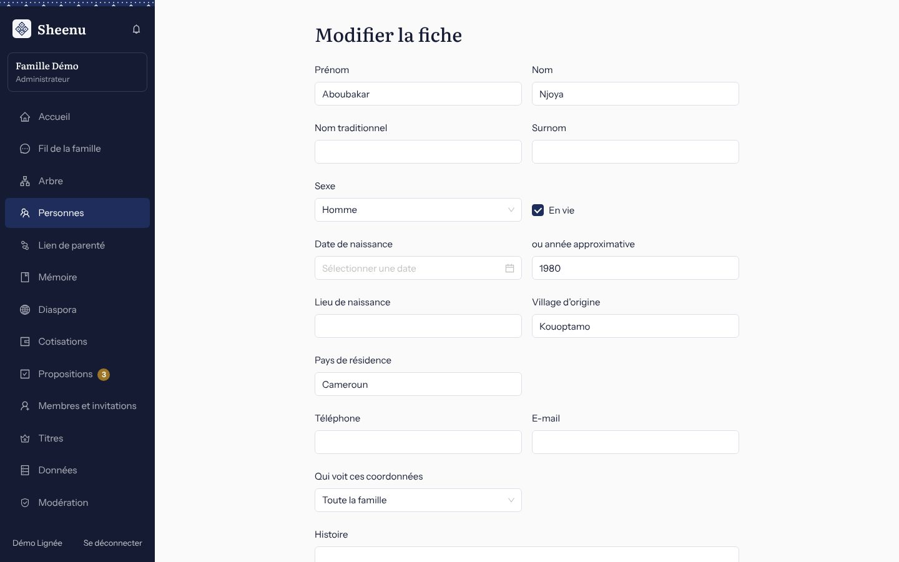

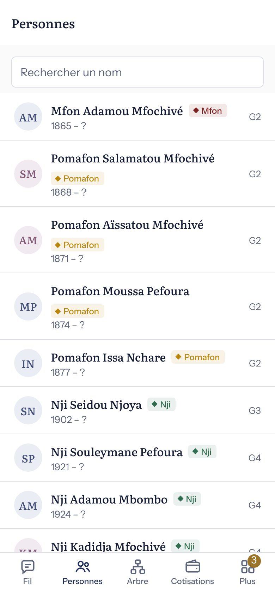 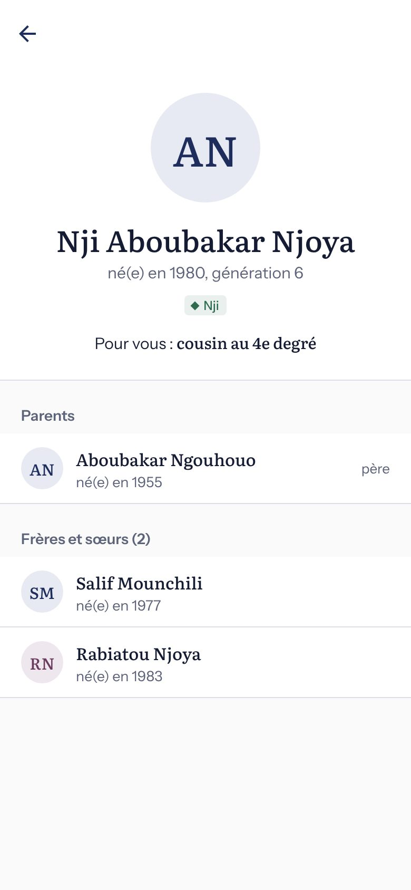

**Code.** `api/app/modules/persons/` ; `web/src/features/persons/` ; `mobile/src/screens/PeopleScreen.tsx`, `PersonScreen.tsx`.

---

## F-10 — Filiations et unions

**Objectif.** Relier les personnes de façon fidèle aux réalités familiales : adoption, polygamie, filiations transmises oralement.

**Règles.**

- RG-08 : au plus deux parents **biologiques** (`too_many_parents`) ; les liens adoptifs ou de reconnaissance s'ajoutent en plus.
- RG-09 : pas de boucle. Avant « P parent de E », le service vérifie que P n'est pas un descendant de E (`cycle_detected`).
- RG-10 : une union a un type (coutumière, civile, religieuse), des dates, une fin éventuelle (divorce, veuvage) et un **rang** pour la polygamie (première, deuxième épouse…).
- RG-11 : chaque lien porte sa certitude (documenté, transmis oralement, incertain) et une source facultative.
- Toute création, modification ou suppression passe au journal (F-16) et incrémente la version de l'arbre (cache, F-11).

**API.** `POST /relations/parent-child`, `PATCH / DELETE /relations/parent-child/{id}`, `POST /unions`, `PATCH / DELETE /unions/{id}`.

**Écrans.** Fiche → « Ajouter » (un parent, un enfant, un conjoint, en choisissant une fiche existante ou en en créant une) ; « Plus » pour les autres actions.

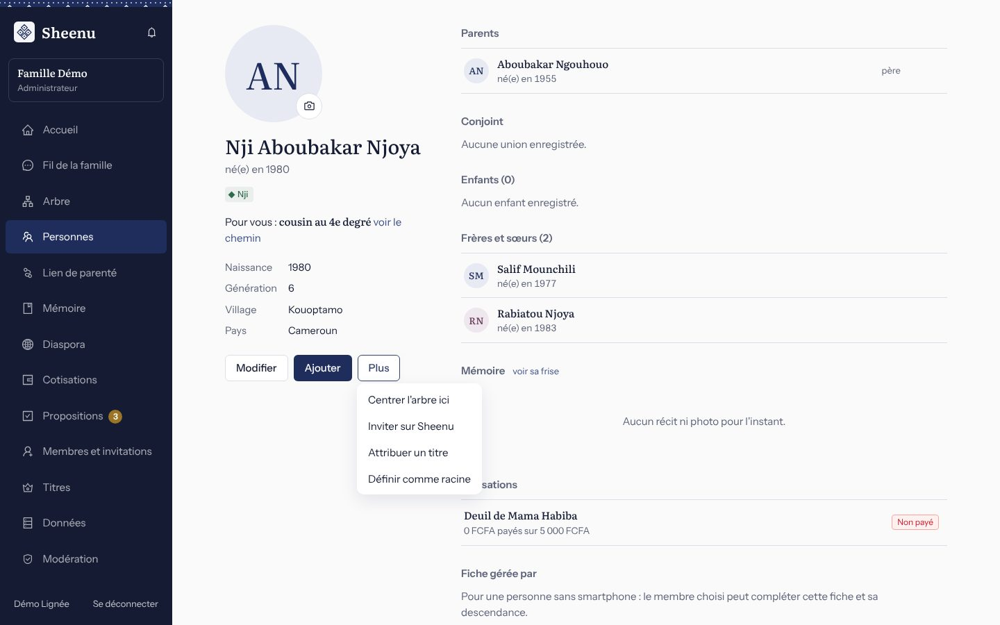

**Code.** `api/app/modules/relations/`, `api/app/genealogy/graph.py` ; `web/src/features/persons/components/`.

---

## F-11 — Arbre interactif et exports

**Objectif.** Voir la famille d'un coup d'œil, l'explorer, l'imprimer pour une réunion.

**Règles.**

- RG-12 : la racine est en génération 1. Un descendant a `1 + plus court chemin depuis la racine` ; un conjoint entré par mariage prend la génération de son conjoint. La racine se change sur sa fiche (« Plus → Définir comme racine ») et peut être remontée en ajoutant ses parents (RG-05).
- Deux vues : **Descendance** et **Ascendance**, centrées sur une personne (`?centre=`), profondeur réglable, zoom, recherche « Centrer sur… ». Un clic sur une personne ouvre un tiroir de résumé.
- Exports : PDF à imprimer, image PNG, SVG vectoriel grand format (avec photos), et GEDCOM (F-17).
- Performance : `/tree` renvoie toutes les personnes et tous les liens d'un coup. Le graphe est gardé en cache par processus et invalidé par `family.graph_version`, que des déclencheurs incrémentent (03 §13.5). 37 ms pour 535 personnes.

**API.** `GET /tree`, `GET /stats`.

**Écrans.**

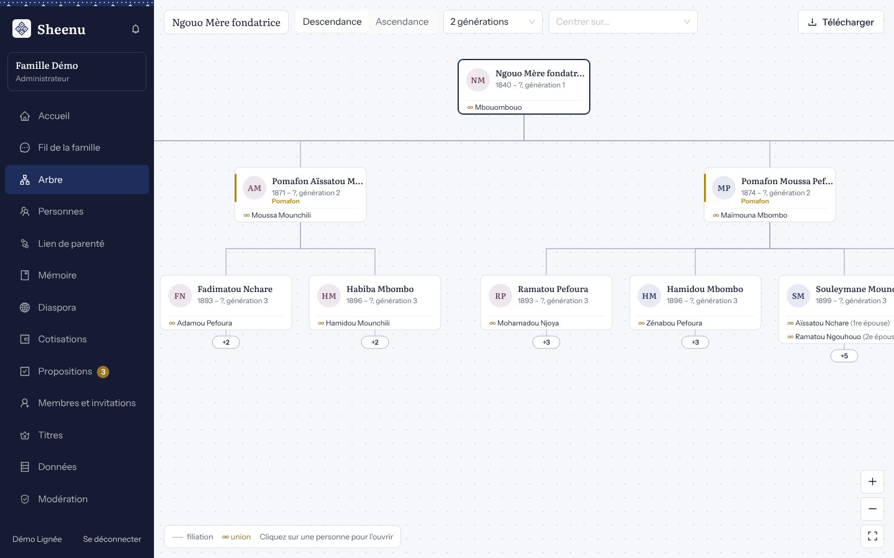

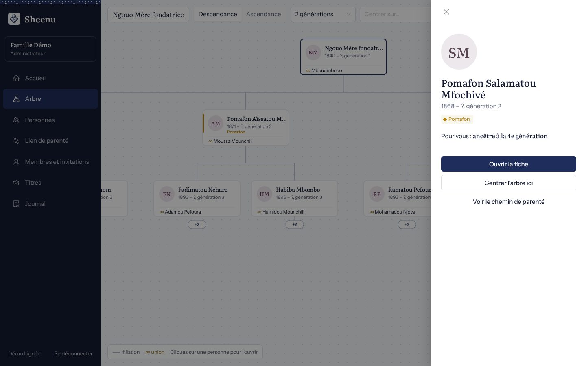

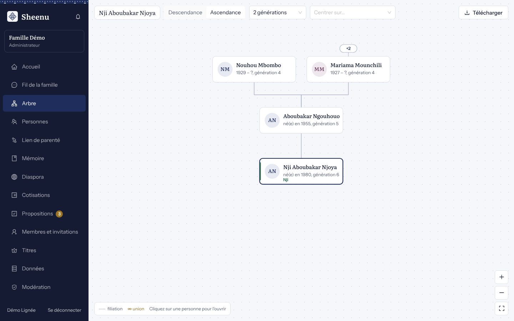

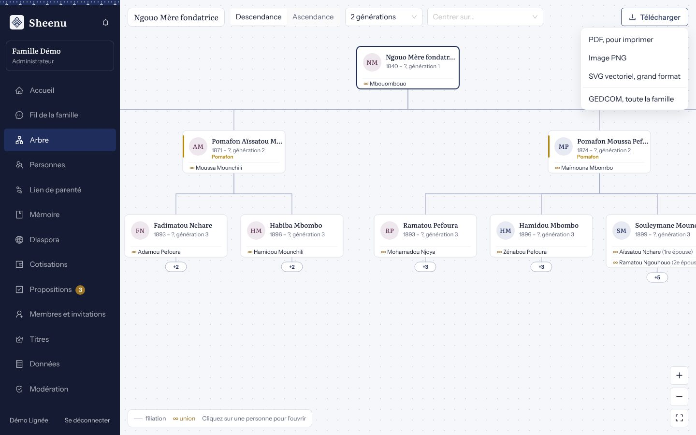

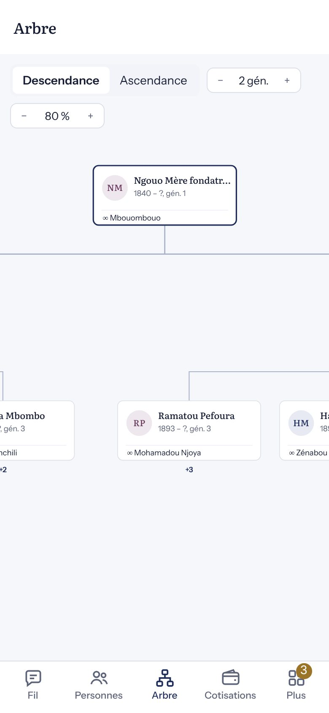 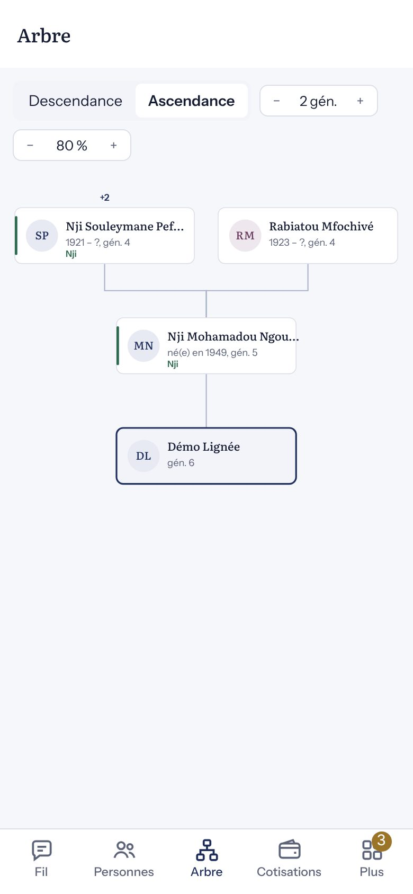

**Code.** `api/app/modules/tree/`, `api/app/genealogy/` ; `web/src/features/tree/` (`layout.ts` pour la disposition, `exporter.ts` pour les exports) ; `mobile/src/screens/TreeScreen.tsx`, `mobile/src/treeLayout.ts`.

---

## F-12 — Lien de parenté

**Objectif.** Répondre à la question que la plateforme est née pour régler : « quel est exactement mon lien avec cette personne ? ».

**Règles** (03 §2.4).

1. Ascendants de A et de B avec leur distance ; ancêtre commun qui minimise `dA + dB`.
2. Nom du lien du point de vue de A, accordé au sexe de B : père, grand-mère, oncle, neveu, cousin germain, cousin au 4ᵉ degré, « décalé de n générations », demi-frère…
3. Sans lien de sang : un niveau d'alliance (époux, conjoint de votre…, … de votre conjoint).
4. Sinon `related = false`.

La fiche affiche « Pour vous : … » avec un lien « voir le chemin ».

**API.** `GET /kinship?from=&to=` → `related`, `label`, `common_ancestor_id`, `path`, `distance_from`, `distance_to`.

**Écrans.** Web `/parente?de=&a=`.

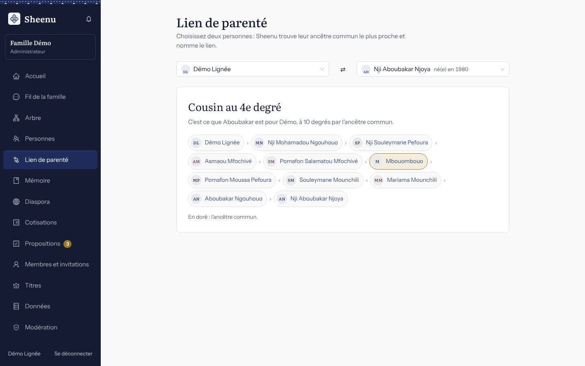

**Code.** `api/app/genealogy/kinship.py` ; `web/src/features/kinship/KinshipPage.tsx`.

---

## F-13 — Titres et préséance

**Objectif.** Respecter la hiérarchie coutumière (Mfon, Nji, Pomafon, Kom…) dans l'affichage et l'ordre des listes.

**Règles.**

- RG-17 : un titre a un nom (unique dans la famille), une abréviation, une couleur de badge et un **rang** (plus petit = plus élevé).
- RG-18, RG-19 : un titre est conféré à une personne avec l'autorité, la date, un justificatif ; un titre transmissible garde ses détenteurs successifs.
- RG-20 : clé de tri = rang du titre actif le plus élevé, puis génération, puis année de naissance, puis nom. Le nom s'affiche précédé de l'abréviation.

**API.** `GET / POST /titles`, `PATCH / DELETE /titles/{id}` (admin) ; `GET / POST /persons/{id}/titles`, `PATCH / DELETE /title-holdings/{id}` (admin).

**Écrans.** Web `/titres` ; fiche → « Plus → Attribuer un titre ».

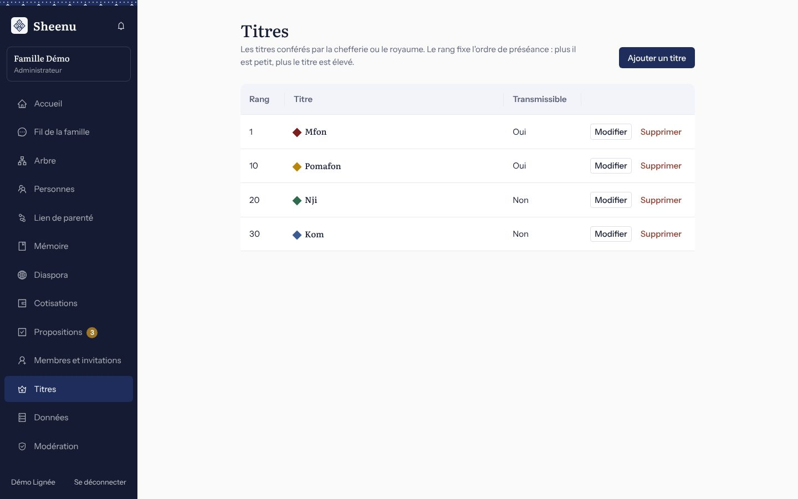

**Code.** `api/app/modules/titles/`, `api/app/genealogy/graph.py` (préséance) ; `web/src/features/titles/`.

---

## F-14 — Périmètre d'écriture et propositions

**Objectif.** Laisser chacun enrichir l'arbre sans que n'importe qui puisse tout modifier (RG-13, RG-14).

**Règles.**

| Rôle | Écrit directement |
|---|---|
| Administrateur | Toute la famille |
| Chef de branche | Sa personne de branche, ses descendants et leurs conjoints |
| Autres | Sa propre fiche, ses descendants et leurs conjoints |
| Tous | En plus, les fiches qui lui sont confiées et leur descendance (F-15) |

- Hors périmètre, la route directe répond `403 out_of_scope` ; le client propose « Envoyer une proposition » avec un message facultatif.
- Types : créer, modifier, archiver une personne ; ajouter ou supprimer une filiation ou une union. Les données sont validées à la création et une phrase lisible est figée.
- Valident : l'administrateur ; un chef de branche si une personne concernée est dans son périmètre ; jamais l'auteur lui-même.
- Accepter exécute exactement le même service que la route directe (mêmes contrôles, même journal). Si l'opération n'est plus possible, l'erreur est renvoyée et la proposition reste en attente. Deux validations simultanées : la seconde reçoit `already_reviewed` (verrou de ligne).
- Refuser exige un motif (`note_required`). L'auteur peut retirer sa proposition tant qu'elle attend.

**API.** `POST /proposals`, `GET /proposals?view=review|mine|all&status=`, `GET /proposals/counts`, `POST /proposals/{id}/accept` | `reject` | `withdraw`.

**Écrans.**

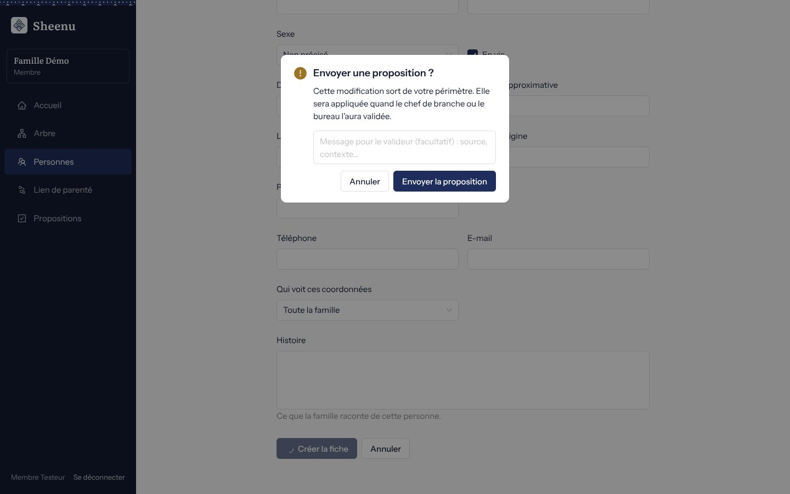

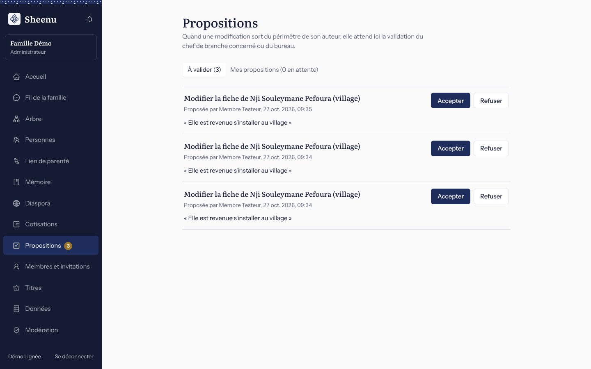

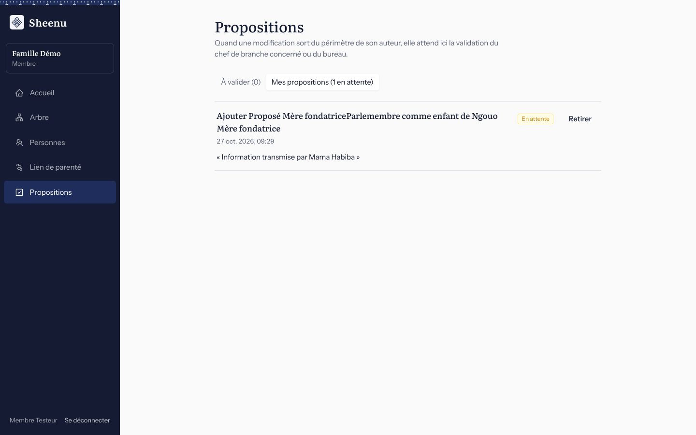

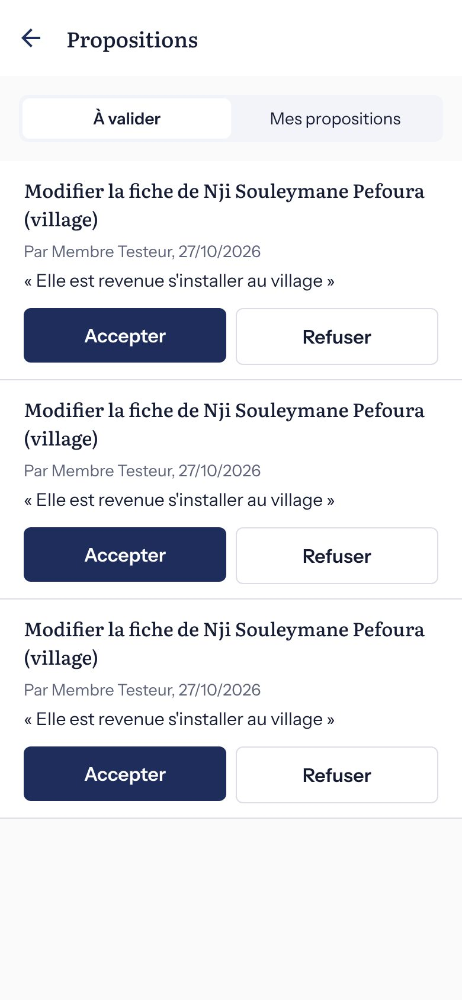

**Code.** `api/app/modules/proposals/`, `api/app/genealogy/graph.py` (`writable_scope`, `can_write`) ; `web/src/features/proposals/` (`useSubmitOrPropose.tsx` bascule de l'écriture directe à la proposition) ; `mobile/src/screens/ProposalsScreen.tsx`.

---

## F-15 — Fiches confiées (délégation)

**Objectif.** Un ancien sans smartphone n'a pas de compte : un membre de confiance tient sa fiche pour lui.

**Règles.**

- Le bureau, ou un chef de branche pour sa branche, confie la fiche à un membre (« Fiche gérée par »).
- Le délégué modifie cette fiche et sa descendance comme s'il s'agissait de la sienne, publie une annonce de vie au nom de l'ancien (F-24), et son numéro sert pour les relances de cotisation de l'ancien (F-22).

**API.** `GET / POST /persons/{id}/delegates`, `DELETE /delegations/{id}`.

**Écrans.** Bas de la fiche, « Fiche gérée par » (voir la capture de F-09, `w11b`).

**Code.** `api/app/modules/delegations/` ; `web/src/features/persons/components/DelegatesSection.tsx`.

---

## F-16 — Journal de la famille

**Objectif.** RG-15 : savoir qui a fait quoi et quand, avec les valeurs avant et après.

**Règles.** Chaque création, modification, suppression (personnes, liens, titres, rôles, cotisations, modération…) écrit une ligne `audit_log`. La table est en **ajout seul** : un déclencheur refuse toute modification ou suppression, même par l'application.

**API.** `GET /audit?entity=&skip=&limit=` (admin).

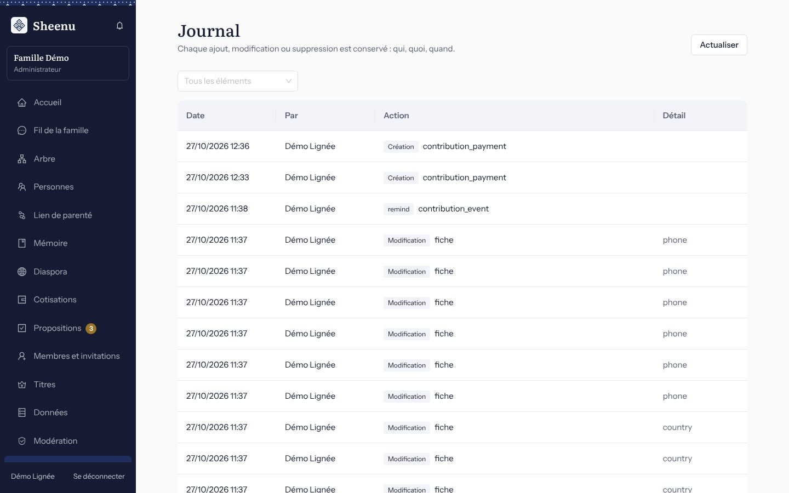

**Code.** `api/app/modules/audit/`, `api/app/shared/audit.py` ; `web/src/features/audit/AuditPage.tsx`.

---

## F-17 — GEDCOM, doublons et fusion

**Objectif.** Ne pas enfermer la famille (export standard), reprendre un arbre existant (import) et nettoyer les fiches en double.

**Règles.**

- **Export GEDCOM 5.5.1** : personnes, unions, enfants. Les vivants sont exportés sans coordonnées.
- **Import** (admin, 10 Mo au plus) : ajoute à l'arbre, ne fusionne rien automatiquement. « 12 MAR 1950 » devient une date ; « ABT 1950 » ou « 1950 » une année.
- **Doublons** : même prénom et nom (sans accents ni casse), années à 2 ans près ou inconnues, aucun lien entre elles, et parents pas tous différents quand ils sont connus. La dernière règle écarte les homonymes, fréquents quand un enfant porte le nom d'un aïeul.
- **Fusion** (« Garder celle-ci ») : filiations, unions, titres, délégations et compte passent sur la fiche gardée ; ses champs vides sont complétés ; l'autre est archivée. Refusée si l'une est ascendante de l'autre ou si les deux ont un compte (`both_have_accounts`).

**API.** `GET /export/gedcom`, `POST /import/gedcom`, `GET /duplicates`, `POST /persons/{id}/merge`.

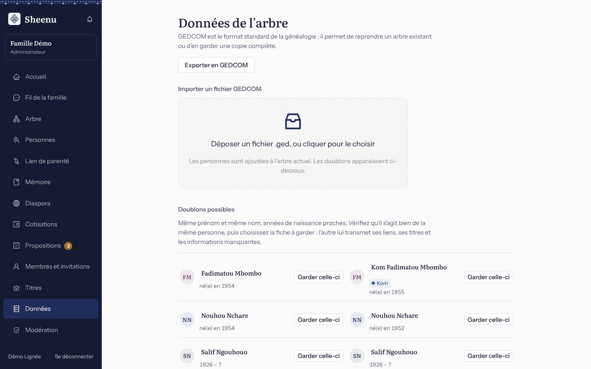

**Code.** `api/app/modules/data/` (`gedcom_export.py`, `gedcom_import.py`, `service.py` pour doublons et fusion) ; `web/src/features/data/DataPage.tsx`.

---

## F-18 — Réunir deux familles

**Objectif.** Deux espaces créés séparément (un foyer et la grande famille, deux branches qui se découvrent) n'en font plus qu'un, sans jamais relier deux familles en permanence.

**Règles.**

1. L'administrateur de la famille **d'accueil** crée un code de réunion (usage unique, 7 jours) avec un texte pour WhatsApp.
2. L'administrateur de la famille **source** ouvre le lien, voit qui le propose, choisit sa famille et confirme. C'est définitif.
3. En une transaction : personnes, filiations, unions, titres (regroupés par nom) et délégations sont copiés ; un inscrit présent des deux côtés garde une seule fiche ; les membres rejoignent la famille d'accueil (un administrateur source devient chef de sa branche, trésorier et secrétaire redeviennent membres).
4. La famille source est marquée réunie (`410 family_merged`) ; ses collectes, propositions et journal restent en archive. Les personnes communes se rapprochent ensuite avec l'outil de doublons (F-17).

**API.** `POST /family-merges`, `GET /family-merges/token/{t}`, `POST /family-merges/token/{t}/accept`.

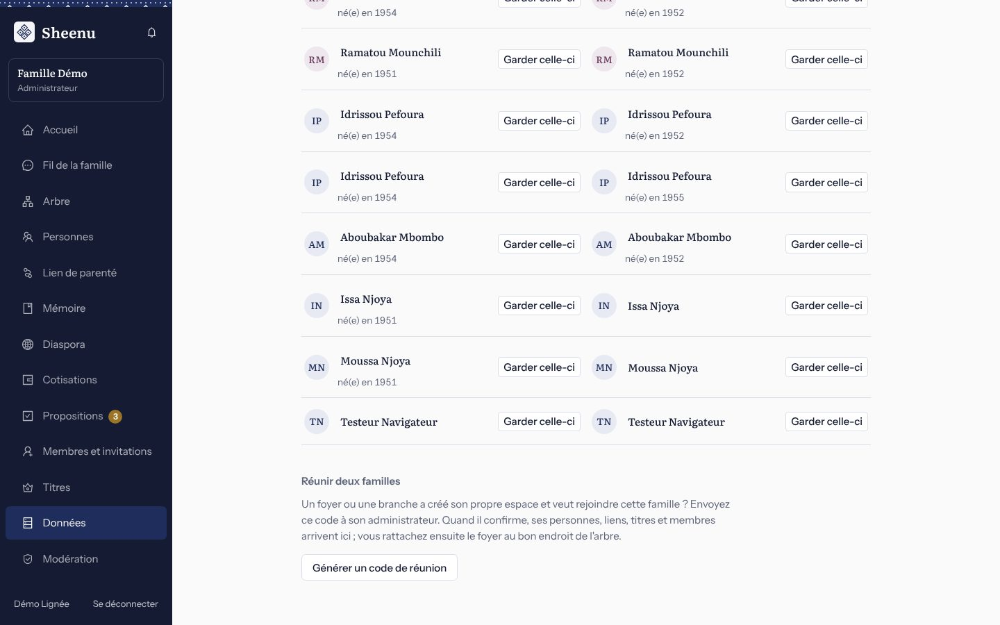

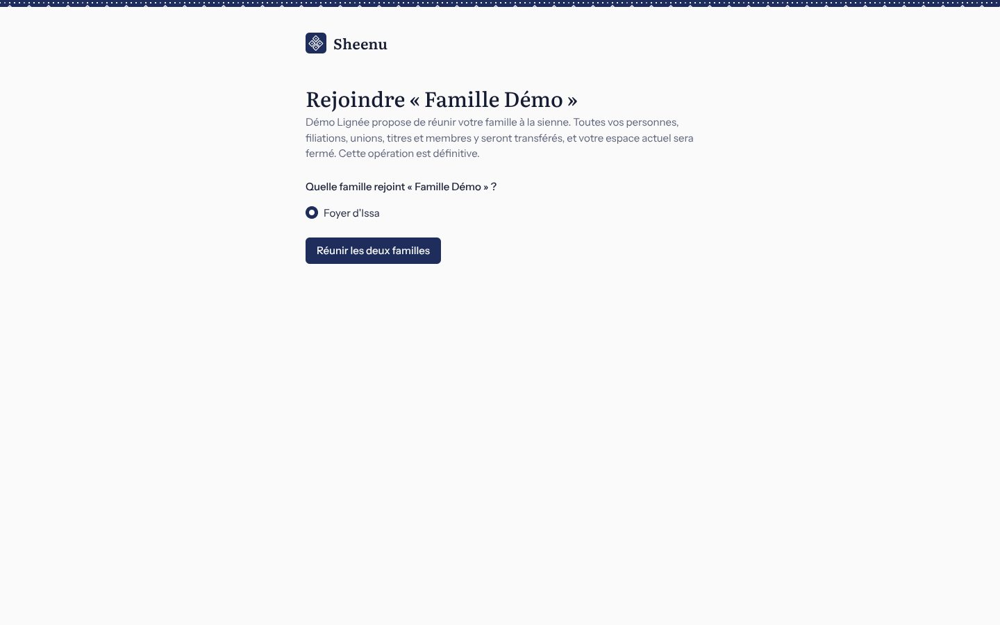

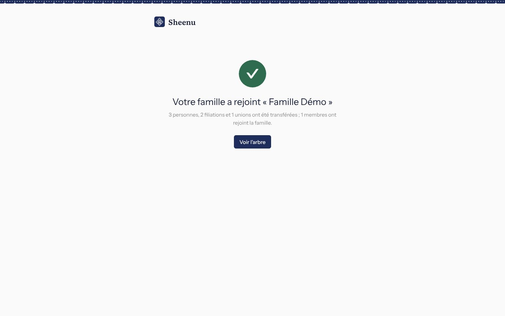

**Code.** `api/app/modules/family_merges/` ; `web/src/features/family-merge/`.

---

## F-19 — Barèmes de cotisation

**Objectif.** Reprendre les textes de l'association : qui doit combien (RG-23).

**Règles.** Un barème a une devise, un montant par **génération**, un montant par défaut, un âge d'exemption, l'inclusion ou non des conjoints, et un état actif. Le modifier n'a aucun effet sur les collectes déjà ouvertes (copie figée, F-20).

**API.** `GET / POST /contributions/scales`, `PATCH /contributions/scales/{id}` (trésorier, admin).

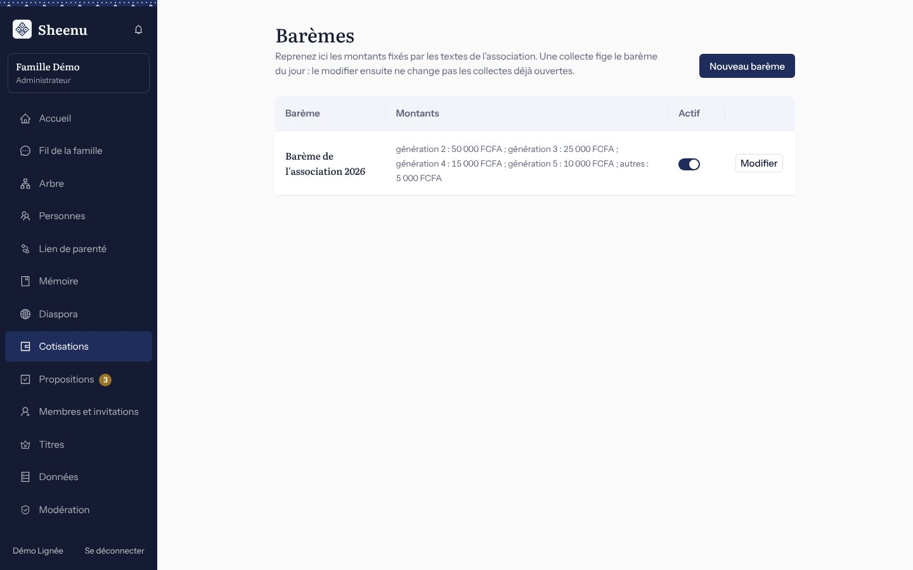

**Code.** `api/app/modules/contributions/` ; `web/src/features/contributions/ScalesPage.tsx`.

---

## F-20 — Collectes et parts dues

**Objectif.** Remplacer les listes recopiées dans WhatsApp lors d'un deuil, d'un mariage ou d'un projet (RG-24).

**Règles.**

- Une collecte a un intitulé, un type (deuil, mariage, naissance, projet, cotisation annuelle…), une échéance, un objectif facultatif et un barème facultatif.
- Avec barème, pour chaque personne **vivante** : rien si conjoint exclu par le barème ou si plus jeune que l'âge d'exemption ; sinon le montant de sa génération, ou le montant par défaut. Le barème est copié dans la collecte (`scale_snapshot`).
- Sans barème : collecte libre.
- Le trésorier ajuste une part, exempte (avec une note) ou ajoute une personne.
- Statut d'une personne : exemptée, à jour (payé ≥ dû), partiel, non payé. Seuls les paiements **validés** comptent.
- Liste par préséance, avec recherche et filtres.

**API.** `GET / POST /contributions/events`, `GET / PATCH /contributions/events/{id}`, `GET / POST /contributions/events/{id}/dues?status=&q=`, `PATCH /contributions/dues/{id}`, `GET /contributions/persons/{id}`.

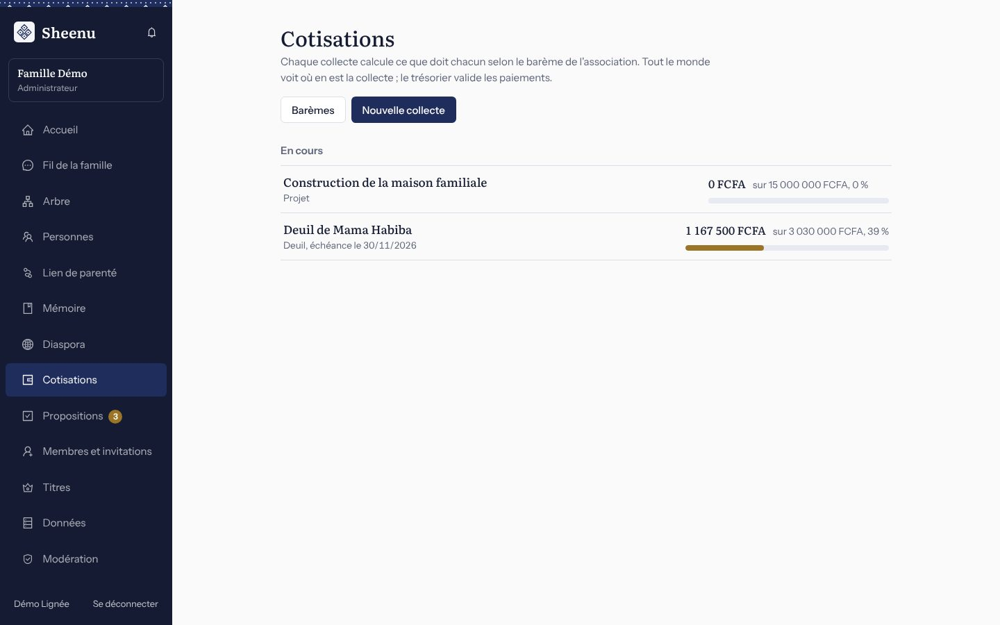

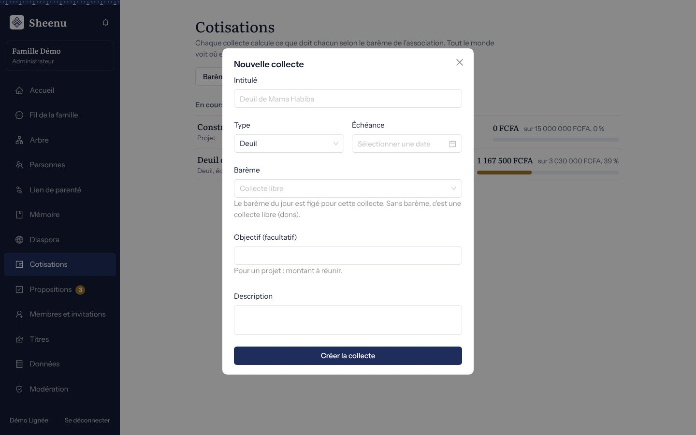

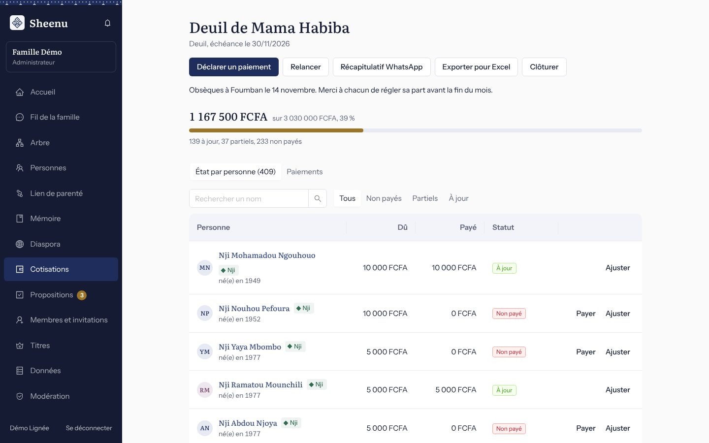

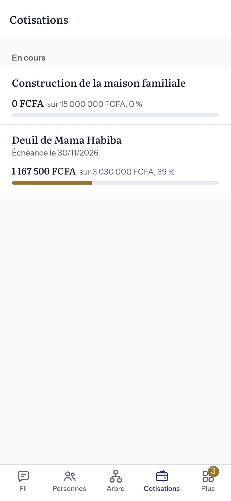 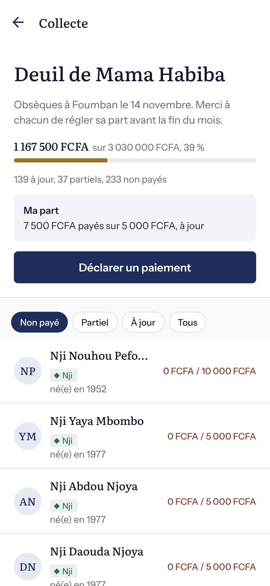

**Code.** `api/app/modules/contributions/service.py` (calcul des parts) ; `web/src/features/contributions/` ; `mobile/src/screens/ContributionsScreen.tsx`, `EventScreen.tsx`.

---

## F-21 — Paiements

**Objectif.** Tracer chaque versement, du membre qui paie au trésorier qui confirme (RG-25).

**Règles.**

- Un membre **déclare** un paiement pour lui ou pour un proche : montant, moyen (Mobile Money, espèces, virement), référence, reçu facultatif ; depuis l'étranger, le montant dans sa devise.
- Le trésorier **valide** (en corrigeant le montant reçu si besoin) ou **refuse** avec un motif. Un paiement saisi par le trésorier (espèces reçues) est validé d'office.
- Les reçus ne sont visibles que du trésorier et de l'auteur ; un membre voit les paiements validés et ses propres déclarations.
- Deux validations simultanées : la seconde reçoit `already_reviewed`. Une déclaration rejouée (même `Idempotency-Key`) n'est créée qu'une fois.
- Collecte close : `event_closed`.

**API.** `GET / POST /contributions/events/{id}/payments`, `POST /contributions/payments/{id}/proof`, `POST /contributions/payments/{id}/validate` | `reject`.

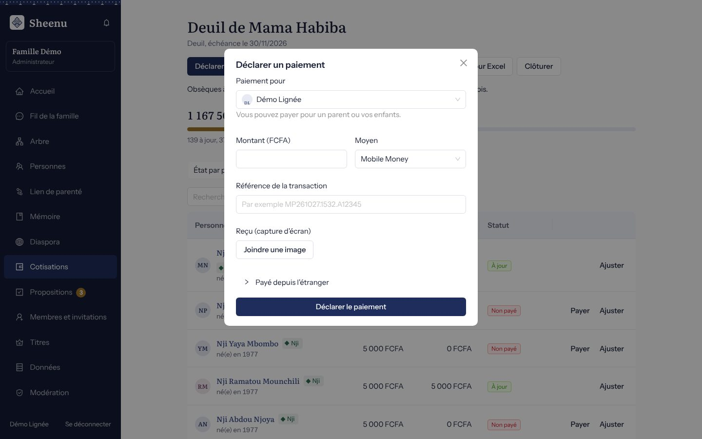

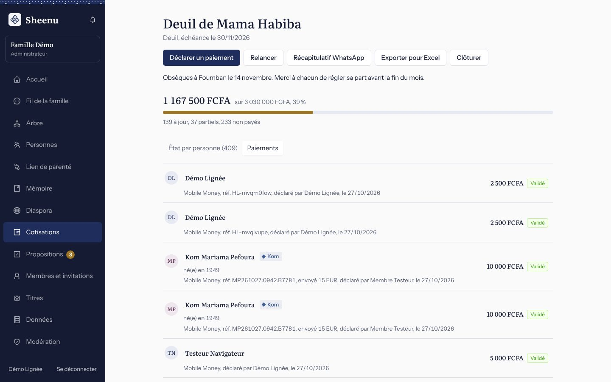

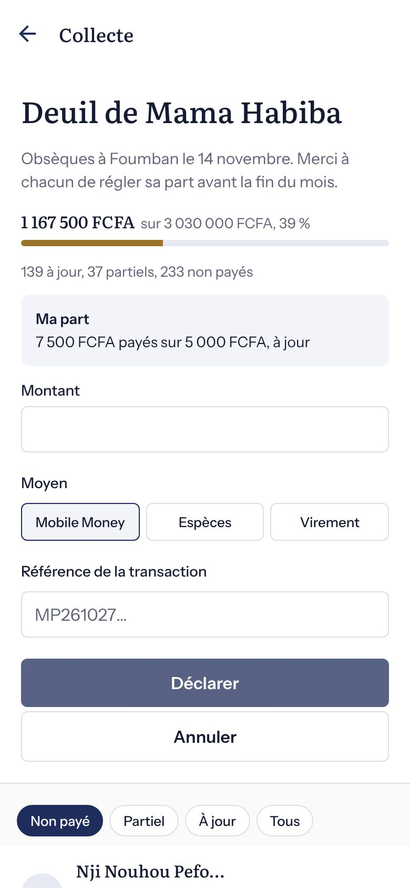

**Code.** `api/app/modules/contributions/router.py`.

---

## F-22 — Récapitulatif, relances, export, clôture

**Objectif.** Faire travailler la plateforme avec WhatsApp plutôt que contre lui.

**Règles.**

- **Récapitulatif WhatsApp** : la liste numérotée de la collecte avec ✅ / ❌, toute la liste ou seulement ceux qui restent à payer, à partager ou copier.
- **Relancer** : un message personnel par personne en retard (sa part, ce qui est versé, ce qui reste), avec une consigne de paiement saisie par le trésorier. Chaque message s'ouvre dans WhatsApp (`wa.me`), ou part par l'API WhatsApp Business si elle est configurée. Numéro : celui de la fiche, sinon du compte, sinon du délégué.
- **Exporter pour Excel** : CSV `;`, UTF-8 avec BOM.
- **Clôturer** : refusé tant qu'un paiement attend ; ensuite plus aucune modification (RG-26).

**API.** `GET /contributions/events/{id}/recap?only_unpaid=`, `POST /contributions/events/{id}/reminders`, `GET /contributions/events/{id}/export.csv`, `POST /contributions/events/{id}/close`.

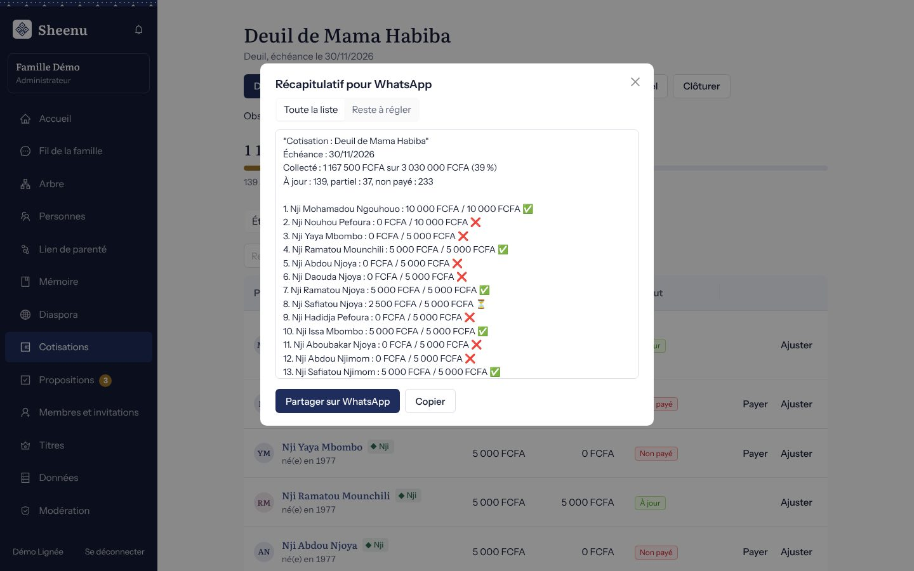

**Code.** `api/app/integrations/messaging.py` ; `web/src/features/contributions/components/`.

---

## F-23 — Paiement Mobile Money

**Objectif.** Payer sa part depuis l'application, la validation arrivant du prestataire sans le trésorier.

**État.** L'interface est prête et testée avec un simulateur (`PAYMENT_BACKEND=sandbox`). Aucun prestataire réel n'est branché : il faut son contrat et sa documentation (voir [04](04-deploiement.md) §4 bis). Désactivé par défaut, d'où l'absence de capture.

**Règles.** Le paiement est créé « déclaré » ; le webhook signé HMAC-SHA256 le passe en « validé » ou « refusé » et prévient le payeur ; un second appel du webhook est sans effet ; une signature invalide est rejetée et inscrite au journal de sécurité.

**API.** `GET /contributions/online`, `POST /contributions/events/{id}/pay-online`, `POST /webhooks/payments/{provider}`.

**Code.** `api/app/integrations/payments.py` (`PaymentGateway.start`, `parse_webhook`).

---

## F-24 — Fil de la famille

**Objectif.** Les nouvelles de la famille, dans un espace privé et ordonné.

**Règles.**

| Type | Qui publie | Effet |
|---|---|---|
| Publication | Tout membre | Texte, photos, personnes identifiées |
| Annonce de vie | Tout membre, aussi au nom d'un ancien confié | Naissance, mariage, décès, réussite ; notifie tout le monde |
| Sondage | Tout membre | Deux choix ou plus ; un vote par membre, modifiable |
| Annonce officielle | Modération | Épinglée en tête, fond laiton, notifie tout le monde |

- Réactions : une par membre (j'aime, j'adore, prières, bravo). Réactions et votes simultanés sont traités par `INSERT … ON CONFLICT`.
- Commentaires ; l'auteur ou la modération les supprime.
- Filtres : tout, annonces, annonces de vie, sondages. Pagination par 20, épinglées d'abord.
- Les photos citées doivent être des médias de la famille (F-35).

**API.** `GET /feed?before=&kind=`, `POST /posts`, `GET / PATCH / DELETE /posts/{id}`, `PUT / DELETE /posts/{id}/reaction`, `POST /posts/{id}/vote`, `GET / POST /posts/{id}/comments`, `DELETE /comments/{id}`, `POST /uploads/image`.

 

**Code.** `api/app/modules/social/posts.py` ; `web/src/features/social/` ; `mobile/src/screens/FeedScreen.tsx`, `PostScreen.tsx`, `mobile/src/components/PostCard.tsx`.

---

## F-25 — Stories

**Objectif.** Partager une photo du moment, visible 24 heures.

**Règles.** Une story expire au bout de 24 h et n'est plus listée. L'auteur la retire avant s'il le souhaite. Affichage en ronds en haut du fil ; un toucher ouvre la visionneuse.

**API.** `GET / POST /stories`, `DELETE /stories/{id}`.

**Code.** `api/app/modules/social/stories.py`.

---

## F-26 — Modération

**Objectif.** Garder le fil respectueux sans censure arbitraire.

**Règles.** Tout membre signale une publication ou un commentaire avec un motif. La modération masque le contenu ou classe le signalement. Un contenu masqué disparaît pour les membres ; la modération le voit, signalé comme tel. Chaque décision est au journal.

**API.** `POST /reports`, `GET /reports`, `POST /reports/{id}/resolve?hide=`.

**Code.** `api/app/modules/social/moderation.py` ; `web/src/features/social/ModerationPage.tsx`.

---

## F-27 — Mémorial et anniversaires

**Règles.**

- **Mémorial** : uniquement sur la fiche d'une personne décédée (`not_deceased` sinon) ; hommages et condoléances ; l'auteur ou la modération retire un message.
- **Anniversaires** : personnes vivantes dont la date complète est connue, sur les 30 prochains jours (1 à 366), avec l'âge atteint. Accueil et fil.

**API.** `GET / POST /persons/{id}/memorial`, `DELETE /memorial/{id}`, `GET /birthdays?days=`.

**Code.** `api/app/modules/social/memorial.py`.

---

## F-28 — Récits et relecture

**Objectif.** Garder les histoires des anciens dans leur langue, avec une transcription et des traductions fidèles, relues par la famille (RG-27 à RG-29).

**Règles.**

- Un récit a un titre, un **média original** (audio ou vidéo, jamais remplacé), un conteur (souvent un ancien sans compte), une langue, une époque libre (« sous le règne du roi Njoya ») et une année approximative, un lieu, les personnes évoquées.
- Média : mp3, m4a, aac, ogg, webm, wav, mp4, mov, 30 Mo au plus, stocké tel quel. Sur le web, le micro du navigateur enregistre directement.
- Trois **couches** de texte : langue d'origine, français, anglais. Chaque couche a une seule version de référence ; chaque proposition est une nouvelle version (`pending`).
- Les gardiens relisent : l'écran montre ajouts et retraits mot à mot par rapport au texte actuel. Valider fait de la proposition la référence (l'ancienne passe en `superseded`, consultable) ; refuser porte un motif visible de l'auteur. La proposition d'un gardien est validée d'office. Deux relectures simultanées : la seconde reçoit `already_reviewed`.
- La transcription automatique n'est pas branchée (aucun service gratuit fiable pour le shüpamom) ; le modèle l'accepte plus tard comme une proposition parmi d'autres.

**API.** `GET / POST /narratives`, `GET / PATCH / DELETE /narratives/{id}`, `GET / POST /narratives/{id}/texts`, `POST /narrative-texts/{id}/validate` | `reject`, `POST /uploads/media`.

 

**Code.** `api/app/modules/memory/narratives.py` ; `web/src/features/memory/` ; `mobile/src/screens/MemoryScreen.tsx`, `NarrativeScreen.tsx`.

---

## F-29 — Albums et reconnaissance

**Règles.** Un album a un titre, une description, une année. On y ajoute plusieurs photos à la fois. Dans la visionneuse, **tout membre** peut reconnaître une personne de l'arbre sur une photo ; la légende et l'année restent à l'auteur de la photo ou aux gardiens. La fiche d'une personne montre les photos où elle est reconnue.

**API.** `GET / POST /albums`, `GET / PATCH / DELETE /albums/{id}`, `POST /albums/{id}/photos`, `PATCH / DELETE /album-photos/{id}`, `GET /persons/{id}/photos`.

 

**Code.** `api/app/modules/memory/albums.py` ; `web/src/features/memory/AlbumsPage.tsx`, `AlbumPage.tsx` ; `mobile/src/screens/AlbumScreen.tsx`.

---

## F-30 — Frise

**Règles.** Les événements datés, décennie par décennie : naissances, unions, décès, récits, albums, annonces de vie. Filtres par type ; centrage sur une personne (`?personne=`, lien « voir sa frise » sur la fiche).

**API.** `GET /timeline?person_id=`.

**Code.** `api/app/modules/memory/timeline.py` ; `web/src/features/memory/TimelinePage.tsx`.

---

## F-31 — Diaspora

**Règles.** Les personnes vivantes comptées par pays de résidence, en regroupant les écritures (« france », « France »). Le web place un cercle proportionnel par pays sur une carte Equal Earth (frontières Natural Earth chargées à la demande) ; un pays inconnu de la table de correspondance reste dans le classement. Un pays choisi liste ses habitants.

**API.** `GET /diaspora`, `GET /persons?country=`.

**Code.** `api/app/modules/overview/` ; `web/src/features/diaspora/`.

---

## F-32 — Résumé de la semaine

**Règles.** Sur 7 jours (1 à 31) : nouvelles personnes, annonces, collectes en cours, nouveaux récits, anniversaires. Texte écrit avec le gras WhatsApp, prêt à coller dans le groupe ; lien de partage `wa.me`. Voir la capture de F-04.

**API.** `GET /digest?days=`.

**Code.** `api/app/modules/overview/router.py` ; `web/src/features/home/WeeklyDigest.tsx`.

---

## F-33 — Hors connexion et synchronisation

**Objectif.** Que l'application mobile reste utile au village, sans réseau, et que rien ne soit perdu ni compté deux fois au retour de la connexion.

**Lecture.**

- À l'ouverture d'une famille et à chaque retour au premier plan, `offline.ts` précharge l'arbre, les personnes, le fil, la mémoire, les notifications, la diaspora, les collectes ouvertes avec leurs parts (et les déclarations à valider pour le trésorier).
- Sans réseau : ces données s'affichent avec un bandeau ; la recherche de personnes et les fiches sont reconstituées depuis l'arbre.

**Écriture.**

- Publier, commenter, réagir, voter, proposer, déclarer un paiement, relire un texte, valider passent par `send()` (`sync.ts`). Sans réseau, l'action entre dans une **file d'envoi** (AsyncStorage `sheenu.outbox`) avec une `Idempotency-Key`, et s'affiche tout de suite « En attente d'envoi ».
- La file repart **dans l'ordre** au changement de connectivité, au retour au premier plan et toutes les 15 s tant que le réseau manque.
- Réponse 4xx : l'envoi passe en échec avec la raison (droits, collecte close, déjà validé) ; l'utilisateur relance ou abandonne. Pas de réseau, 5xx, 409 `in_progress` ou 429 : l'envoi reste en file.
- Côté serveur, l'`Idempotency-Key` garantit qu'une action renvoyée après une coupure en plein envoi n'est exécutée qu'une fois.
- La déconnexion vide la file et le cache.
- Web : bandeau hors connexion seulement ; pas de file d'envoi.

**Écrans.**

  

  

 

**Code.** `mobile/src/sync.ts`, `mobile/src/offline.ts`, `mobile/src/api.ts` (cache, `ping`), `mobile/src/screens/PendingScreen.tsx` ; `api/app/security/middleware.py` (`Idempotency`) ; `web/src/components/OfflineBanner.tsx`.

---

## F-34 — Supervision de la plateforme

**Objectif.** Permettre à l'opérateur de faire tourner Sheenu pour toutes les familles, avec un audit de ses propres actions, sans jamais lire le contenu des familles.

**Acteurs.** Opérateur (`user.is_platform_admin`), nommé **uniquement** en ligne de commande : `python -m app.cli operator add|remove|list`.

**Règles.**

- **Vue d'ensemble** : comptes, familles, requêtes et temps de réponse des 24 dernières heures, erreurs, alertes ; santé (isolement des familles actif, base, schéma, stockage, messagerie, paiement, limitation de débit).
- **Sécurité** : journal `security_event` filtrable par gravité et type (connexions refusées, verrouillages, débit dépassé, accès à une famille étrangère, jeton réutilisé, webhook falsifié, fichier refusé, erreur serveur…).
- **Comptes** : recherche, filtres (verrouillés, suspendus, opérateurs) ; suspendre, réactiver, déverrouiller, déconnecter partout. Chaque action exige un motif.
- **Familles** : des nombres seulement (membres, fiches, publications, récits, création, dernière activité), calculés famille par famille dans leur contexte RLS.
- **Journal de l'opérateur** (`platform_audit`) : chaque consultation et chaque action, avec date, auteur, IP et motif, en ajout seul.
- **Purge** : clés d'idempotence de plus de 48 h, compteurs de plus de 90 jours. Les journaux ne sont jamais purgés.

**API.** `GET /platform/overview`, `/traffic?hours=`, `/events`, `/users`, `/families`, `/audit` ; `POST /platform/users/{id}/disable` | `enable` | `unlock` | `revoke-sessions` ; `POST /platform/maintenance/purge`. Toute autre personne reçoit 403.

**Code.** `api/app/modules/platform/`, `api/app/cli.py` ; `web/src/features/platform/`.

---

## F-35 — Sécurité transverse

Ces mécanismes n'ont pas d'écran propre ; ils protègent toutes les fonctionnalités. Détail et tests : [07 — Tests et sécurité](07-tests-et-securite.md).

| Mécanisme | Effet | Code |
|---|---|---|
| Row Level Security | Chaque requête fixe `app.family_id` ; la base filtre toutes les tables de famille. Le rôle applicatif n'est ni superutilisateur ni `BYPASSRLS` | `api/app/core/db.py`, migrations |
| Sessions et rotation | Une session par appareil, jeton de rafraîchissement à usage unique, rejeu détecté | `api/app/modules/auth/` |
| Verrouillage, débit | 5 échecs, limites par IP, par compte et par catégorie | `api/app/security/ratelimit.py` |
| Corps et fichiers | 1 Mo en JSON, 32 Mo en multipart ; images vérifiées par signature d'octets et taille en pixels | `api/app/security/middleware.py`, `api/app/shared/storage.py` |
| Médias signés | Liens HMAC valables 6 h, ou présignés S3 ; un contenu ne cite que des médias de sa famille | `api/app/security/media.py` |
| Idempotence | `Idempotency-Key` : une action rejouée n'est exécutée qu'une fois | `api/app/security/middleware.py` |
| Concurrence | Upserts sur réactions et votes, verrous `FOR UPDATE` sur les validations | services concernés |
| Journaux inaltérables | `audit_log`, `platform_audit`, `security_event` en ajout seul (déclencheurs) | migration 0008 |
| En-têtes | CSP, HSTS, `X-Frame-Options`, `nosniff`, `Referrer-Policy`, `Permissions-Policy` | middleware, `web/vercel.json` |
| Refus de démarrer | En production : secrets faibles, CORS `*`, adresses non HTTPS | `api/app/core/config.py` |

---

## Navigation mobile

Cinq onglets : **Fil**, **Personnes**, **Arbre**, **Cotisations**, **Plus**. « Plus » mène aux notifications, aux envois en attente (quand il y en a), à sa fiche, à la mémoire, à la diaspora, aux propositions, au changement de famille et à la déconnexion. Le compteur de l'onglet additionne notifications non lues, propositions à valider et envois en attente.

L'application Android se construit sans compte Expo par le workflow GitHub Actions **APK Android** (`.github/workflows/android-apk.yml`) : `expo prebuild` puis Gradle. L'adresse de l'API est un paramètre du lancement (`EXPO_PUBLIC_API_URL`).

## Ce qui n'est pas encore fait

| Sujet | État |
|---|---|
| Mot de passe oublié | Pas d'envoi automatique de code (il faut un service e-mail ou SMS) ; l'opérateur aide à retrouver l'accès |
| Restriction de récits ou de filiations sensibles à une branche (RG-22) | Non implémentée : tout le contenu d'une famille est visible de ses membres |
| Prestataire Mobile Money réel | Interface prête, simulateur seulement (F-23) |
| Transcription automatique | Non branchée (F-28) |
| File d'envoi hors connexion sur le web | Bandeau seulement (F-33) |
| Notifications push sur le téléphone | Notifications dans l'application seulement |
